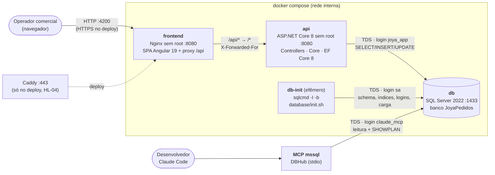
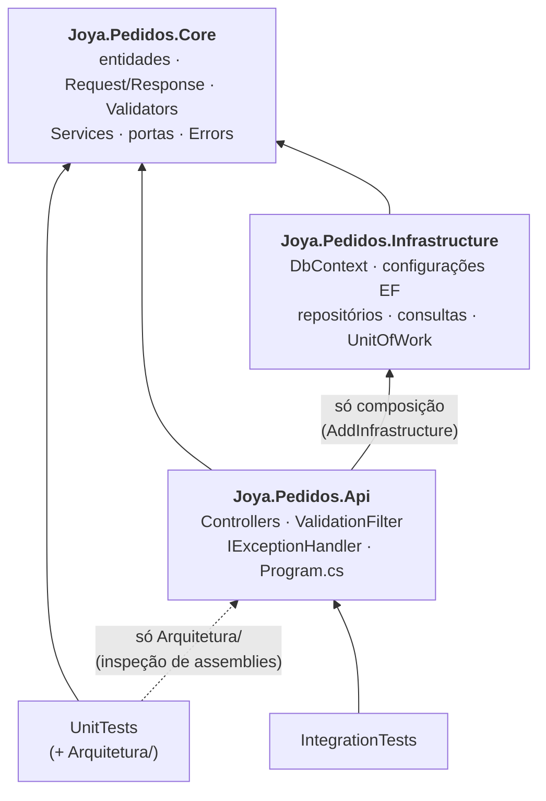
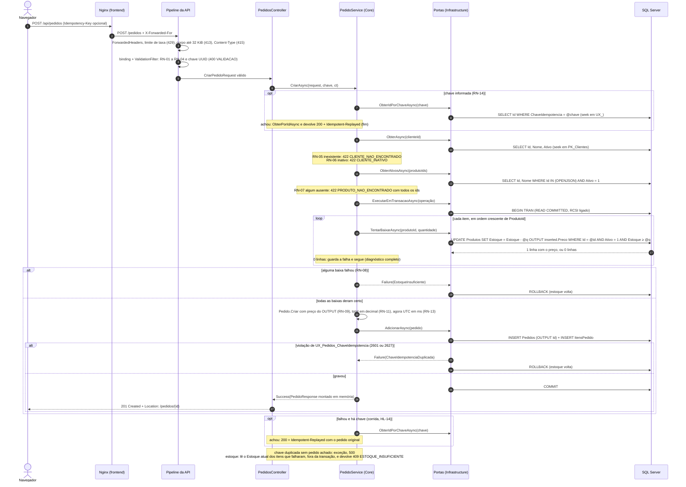
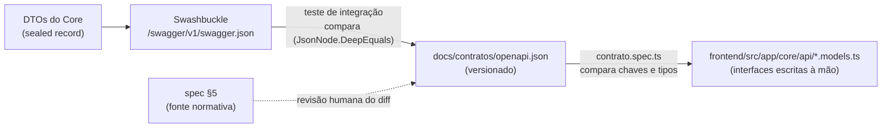

# Relatório da etapa 2 — Arquitetura (`arquiteto`)

> Modelo: [templates/relatorio-etapa.md](templates/relatorio-etapa.md). Rodadas novas são acrescentadas; as antigas não são reescritas.
> Entradas: [enunciado.md](../requisitos/enunciado.md) (`ENU-Lxxx`), [01-requisitos.md](01-requisitos.md), [backlog.md](backlog.md), [spec.md](../spec.md), [plan.md](../plan.md) (`D-xx`, `HL-01` a `HL-16`) e [CLAUDE.md](../../CLAUDE.md).
> Decisões que já estão no plano (`D1` a `D16`, `HL-xx`) são **referenciadas, não repetidas**. Decisões novas estão nos ADRs `0002` em diante.

## Rodada 1 — 2026-11-13 — DESENHO

## 1. Restrições da vaga

Só entram aqui restrições **técnicas** do enunciado, ou seja, as que limitam o desenho. Os requisitos de processo e de entrega (README, vídeo, commits) estão no relatório da etapa 1.

| # | Restrição | ENU | Resposta do desenho | Como se verifica |
|---|---|---|---|---|
| R-01 | Banco **SQL Server** | ENU-L025 | SQL Server 2022 (`mcr.microsoft.com/mssql/server:2022-latest`) no compose, nos testes (Testcontainers) e no deploy | `docker compose config` e a imagem do fixture |
| R-02 | Tabelas `Clientes`, `Produtos`, `Pedidos` e `ItensPedido`, com PKs, FKs e índices adequados | ENU-L027 | Nomes exatos da spec §6. Cada índice está ligado a uma consulta na §6 deste documento | `Schema_ScriptsAplicados_CriaTabelasChavesEConstraints`, `Indices_ScriptAplicado_ExistemIndicesDaSpec` |
| R-03 | Scripts de criação **e** de carga em `database/` | ENU-L028 | `database/*.sql` é a única fonte do schema (`D6`). Um único executor (`database/init.sh`) serve ao compose e aos testes ([ADR-0003](../adr/0003-banco-real-nos-testes-de-integracao.md)) | Checklist `DB-01`, `DB-02` |
| R-04 | Backend **.NET 8 ou superior** | ENU-L029 | .NET 8 (LTS), C# 12, `global.json` fixando o SDK 8 | `dotnet --version` no CI; `TargetFramework` em `Directory.Build.props` |
| R-05 | Rotas exatas `POST /pedidos`, `GET /pedidos`, `GET /relatorios/top-clientes` | ENU-L031 a L033 | Rotas na raiz da API, sem prefixo nem versão. O prefixo `/api` existe só no Nginx, que o remove antes de repassar | Contrato `docs/contratos/openapi.json` (§5) |
| R-06 | Validar "se o cliente existe e se há estoque suficiente" | ENU-L031 | RN-05 a RN-08 no `PedidoService`. Estoque pela instrução atômica da spec §4.3 (`D5`, `D7`) | §4 deste documento; CA-05, CA-08, CA-10 |
| R-07 | Frontend **React ou Angular, com TypeScript** | ENU-L034 | Angular 19 standalone, TypeScript `strict` (`D12`) | `npm --prefix frontend run build` |
| R-08 | Tela de listagem com filtros e tela **ou modal** de criação | ENU-L036, L037 | Duas rotas: `/pedidos` e `/pedidos/novo` (`D13`) | CA-28 a CA-32 |
| R-09 | MCP conectado ao **SQL Server** | ENU-L022 | DBHub com o login `claude_mcp`, somente leitura e `SHOWPLAN` (`D16`, spec §6.5) | `claude mcp list`; `LoginMcp_TentaEscrever_PermissaoNegada` |
| R-10 | Query da Parte 4 corrigida e otimizada, investigada com **plano de execução** | ENU-L040 a L048 | Nenhum índice novo é necessário: os índices da spec §6.3 já atendem a query corrigida (§6). Os planos são capturados pelo MCP | CA-33; `database/parte4/investigacao.md` |
| R-11 | Testes unitários no backend, cobrindo regras e validações do pedido | ENU-L054 | Regras no `Core`, sem I/O, testadas com portas substituídas (NSubstitute, `D11`) | `dotnet test backend/tests/Joya.Pedidos.UnitTests` |
| R-12 | Testes de integração contra **SQL Server real** | ENU-L055 | Testcontainers + `WebApplicationFactory` + Respawn (`D10`), aplicando os **mesmos** scripts com o **mesmo** executor, e a API conectada como `joya_app` ([ADR-0003](../adr/0003-banco-real-nos-testes-de-integracao.md)) | `dotnet test backend/tests/Joya.Pedidos.IntegrationTests` |
| R-13 | Tudo no Docker, com `docker-compose.yml` **na raiz** | ENU-L061 | Serviços `db`, `db-init`, `api` e `frontend` num único arquivo na raiz | `docker compose config` |
| R-14 | Scripts de criação e carga executados **automaticamente** | ENU-L063 | `db-init` efêmero (`D15`), encadeado por `depends_on` com condição | `docker compose ps -a` mostra `db-init` com `Exited (0)` |
| R-15 | **Um único comando** (`docker compose up`) | ENU-L066, L068 | Todos os serviços com `build:` e imagem; nenhuma variável sem valor padrão; nenhum `.env` obrigatório (`HL-15`) | Checklist `DK-01` a `DK-03` |
| R-16 | Playwright (diferencial) | ENU-L058, L085 | `e2e/` contra o compose em execução | `npm --prefix e2e test` |
| R-17 | GitHub Actions a cada push e PR (diferencial) | ENU-L086 | Jobs do backlog US-03 | `gh run list` |
| R-18 | Deploy online (diferencial) | ENU-L087 | O mesmo compose numa VM, com Caddy na frente (`HL-04`) | URL pública |

**Restrições que vêm das decisões humanas**, e não do enunciado, mas que o desenho também precisa respeitar:

- **`HL-03`**: API sem autenticação. Por isso os limites contra abuso da `HL-12` são a única proteção do `POST` no deploy público.
- **`HL-08`**: ArchUnitNET (`TngTech.ArchUnitNET.xUnit`) é a única dependência nova, só no projeto de testes.
- **`HL-12`**: limite de corpo (`413`) e *rate limiter* nativo (`429 LIMITE_DE_TAXA`). Os valores estão no [ADR-0002](../adr/0002-limites-contra-abuso.md).
- **`HL-14`**: corrida na idempotência → rollback e `200` com `Idempotent-Replayed: true` (§4).
- **`HL-15`**: `docker compose up` sem flags num clone limpo.

## 2. Visão de componentes (C4 nível 2)

| Contêiner | Imagem | Porta publicada no host | Depende de | Responsabilidade |
|---|---|---|---|---|
| `db` | `mssql/server:2022-latest` | `127.0.0.1:1433` (só *loopback*: MCP e `dotnet run`) | — | Dados. `healthcheck` com `sqlcmd ... -Q "SELECT 1"` |
| `db-init` | mesma imagem do `db` (já traz `sqlcmd` em `/opt/mssql-tools18`) | nenhuma | `db: service_healthy` | Roda `database/init.sh`: scripts em ordem, `-I -b -C`, senhas por `-v`. Sai com 0 |
| `api` | `backend/Dockerfile` (`sdk:8.0` → `aspnet:8.0`, usuário `app`) | `127.0.0.1:8080` (Swagger) | `db-init: service_completed_successfully` | HTTP, regras, persistência. `healthcheck` em `/health/ready` |
| `frontend` | `frontend/Dockerfile` (Node → `nginx-unprivileged`) | `127.0.0.1:4200 → 8080` (só *loopback*, `SEC-04`) | `api: service_healthy` | SPA com *fallback* para `index.html`; `location /api/ { proxy_pass http://api:8080/; }` |
| MCP `mssql` | fora do compose (processo local do Claude Code) | — | `db` e `db-init` | Inspeção de schema, dados e planos (`D16`) |

Pontos de desenho que valem para todas as histórias:

1. **Mesma origem.** O navegador só fala com o `frontend`. O Nginx tira o prefixo `/api` (barra final no `proxy_pass`), e a API não precisa de CORS (`D14`). No desenvolvimento, o `proxy.conf.json` do Angular faz o mesmo para `localhost:8080`.
2. **`Location` relativo.** O `201` devolve `Location: /pedidos/{id}`, como na spec §5.2. O controller usa `Created($"/pedidos/{id}", corpo)`, e **não** `CreatedAtAction`: este gera URL absoluta com o host interno (`http://api:8080/...`) quando a API está atrás do proxy.
3. **Ordem de subida sem `sleep`.** `db` saudável → `db-init` concluído → `api` saudável → `frontend`. A imagem `aspnet:8.0` não traz `curl`. O `healthcheck` da API usa uma ferramenta que já está na imagem ou um binário mínimo instalado no estágio final; a escolha é do `backend` (T-13.1), e o requisito é: só fica saudável quando `/health/ready` devolve `200`.
4. **`/health/ready` sem pacote novo.** Um `IHealthCheck` próprio chama `DbContext.Database.CanConnectAsync(ct)`. O pacote `Microsoft.Extensions.Diagnostics.HealthChecks.EntityFrameworkCore` **não** é adicionado (regra de ouro 12).
5. **IP real do cliente.** O *rate limiter* particiona por IP, então a API precisa do IP de quem chamou, e não do IP do Nginx. A API usa `UseForwardedHeaders` com `ForwardedLimit` configurável: `1` no compose local e `2` no deploy, onde o Caddy fica na frente do Nginx. Detalhes e riscos estão no [ADR-0002](../adr/0002-limites-contra-abuso.md).
6. **Portas no *loopback*.** `1433`, `8080` e `4200` são publicadas só em `127.0.0.1`. O MCP, o Swagger e a SPA funcionam pela própria máquina, e nem o banco nem a API sem autenticação ficam expostos na rede local: o Nginx repassa `/api` inteiro, inclusive o Swagger, então publicar o `4200` em todas as interfaces exporia a API (`SEC-04`, ajuste da revisão de arquitetura, rodada 3). No deploy, só o Caddy publica porta.
7. **Segredos.** As senhas do compose usam `${VAR:-valor-de-dev}`. O compose sobe sem `.env` (`HL-15`), e o `.env.example` documenta como sobrescrever. O valor padrão vale só para desenvolvimento, e o README avisa isso.

## 3. Camadas e regra de dependência

Três projetos de produção (`D1`) e dois de teste. Não há camada de "aplicação" separada do domínio: com 3 endpoints, ela só repassaria chamadas.

| Projeto | Pode referenciar | Não pode referenciar | O que mora aqui |
|---|---|---|---|
| `Core` | BCL e `FluentValidation` (os validators são parte das regras RN-01 a RN-04 e RN-15) | Qualquer outro projeto da solução; `Microsoft.EntityFrameworkCore*`, `Microsoft.AspNetCore*`, `Microsoft.Data.SqlClient`, `Microsoft.Extensions.DependencyInjection*`, `Microsoft.Extensions.Logging*` | Entidades (`Pedido`, `ItemPedido`), `Request`/`Query`/`Response`, `Validator`, `Service`, portas (`I*Repository`, `I*Consultas`, `IUnitOfWork`), `*Errors`, `Result<T>`, `Error`, `PaginaResponse<T>`, `Periodo` |
| `Infrastructure` | `Core`; `Microsoft.EntityFrameworkCore.SqlServer` | `Api`; `Microsoft.AspNetCore*` | `PedidosDbContext`, `IEntityTypeConfiguration<>`, implementações das portas, `UnitOfWork`, `AddInfrastructure(IServiceCollection, string)` |
| `Api` | `Core`, `Infrastructure` (só em `Program.cs` e na extensão de composição); `Swashbuckle.AspNetCore` | `Microsoft.Data.SqlClient` e `DbContext` fora da composição | Controllers, `ValidationFilter`, `IExceptionHandler`, mapeamento `Error` → HTTP, health checks, limites (ADR-0002) |

Decisões de fronteira que evitam camadas extras:

1. **Portas de leitura no `Core`, projeção na `Infrastructure`.** As consultas (`IPedidoConsultas`, `IRelatorioConsultas`, `IClienteConsultas`, `IProdutoConsultas`) devolvem os `*Response` do `Core`. A implementação projeta com `Select` direto para esses DTOs (regra de ouro 10). Não existe um segundo conjunto de DTOs na `Api`: o controller devolve o `Response` do `Core`, e o contrato é um só.
2. **Um único lugar traduz `Error` em HTTP.** Uma extensão na `Api` (por exemplo, `ResultadoHttp.ParaProblemDetails`) mapeia `Error.Tipo` (`Validacao`, `NaoEncontrado`, `RegraDeNegocio`, `Conflito`) para `400`, `404`, `422` e `409`. Os controllers não escolhem status de erro.
3. **O mesmo `400` para todo erro de entrada.** O `ValidationFilter` (`D9`) e o `InvalidModelStateResponseFactory` do `[ApiController]` produzem o mesmo corpo `VALIDACAO` da spec §5.2. Assim, JSON malformado, tipo errado, `Idempotency-Key` que não é UUID (ligado como `[FromHeader] Guid?`) e RN-01 a RN-04 têm o mesmo formato.
4. **Datas de filtro chegam como texto.** `dataInicio` e `dataFim` são `string?` no `Query`. O validator e `Periodo.Criar` aplicam `DateOnly.TryParseExact(valor, "yyyy-MM-dd", CultureInfo.InvariantCulture, ...)`. O *model binding* de `DateOnly` com a cultura invariante aceitaria `11/13/2026`, o que contraria a spec §5.1. `Periodo` expõe `Inicio` e `FimExclusivo` como `DateTime` UTC (RN-15).
5. **Registro de validators sem pacote extra.** A `Api` registra cada `IValidator<T>` à mão (são quatro) ou por varredura de assembly com reflexão simples. O pacote `FluentValidation.DependencyInjectionExtensions` não é adicionado.
6. **`TimeProvider.System`** é registrado na `Api` e injetado no `PedidoService` (RN-13).

### Como a regra é provada

Os testes de arquitetura ficam em **`backend/tests/Joya.Pedidos.UnitTests/Arquitetura/`**. Isso confirma a sugestão do PO (T-03.2). Não vale um projeto a mais só para eles. O `UnitTests` passa a referenciar `Api` e `Infrastructure` para carregar os assemblies, e uma regra impede que os testes de regra de negócio usem essa referência.

| Teste (`RegrasDeArquiteturaTests`) | Regra | Mecanismo |
|---|---|---|
| `Core_Dependencias_NaoReferenciaEfAspNetNemSqlClient` | `Core` livre de EF, ASP.NET Core, SqlClient, DI e Logging | `Assembly.GetReferencedAssemblies()` do `Core` contra a lista proibida. Reflexão pura, porque o ArchUnitNET só enxerga tipos usados e não pacotes referenciados |
| `Core_Dependencias_NaoReferenciaInfrastructureNemApi` | Dependências apontam para o `Core` | ArchUnitNET: tipos de `Joya.Pedidos.Core` não dependem de `Joya.Pedidos.Infrastructure*` nem `Joya.Pedidos.Api*` |
| `Infrastructure_Dependencias_NaoReferenciaApi` | `Infrastructure` não conhece HTTP | ArchUnitNET e `GetReferencedAssemblies()` sem `Microsoft.AspNetCore*` |
| `Controllers_Dependencias_NaoAcessamDbContext` | Controller só fala com `Service`/porta | ArchUnitNET: classes `*Controller` não dependem de `Microsoft.EntityFrameworkCore*` nem de `Joya.Pedidos.Infrastructure*` |
| `Dtos_Declaracao_SaoSealedRecord` | Regra de ouro 2 | Tipos `*Request`, `*Query`, `*Response` são `sealed` e têm o método `<Clone>$` gerado pelo compilador para `record` |
| `Entidades_Propriedades_NaoTemSetterPublico` | Regra de ouro 2 | Reflexão sobre `Pedido` e `ItemPedido`: nenhum `SetMethod` público |
| `MetodosAsync_Assinatura_RecebemCancellationTokenPorUltimo` | Regra de ouro 3 | Reflexão sobre os assemblies de produção: método público ou de interface que devolve `Task`/`ValueTask` e termina em `Async` tem `CancellationToken` como último parâmetro. Ficam de fora os métodos herdados do framework (`IExceptionHandler.TryHandleAsync`, filtros) |
| `Classes_Declaracao_SaoSealed` | Convenção C# do `CLAUDE.md` | ArchUnitNET: classes concretas não abstratas são `sealed`. Ficam de fora `Program` e os tipos gerados pelo compilador |
| `TestesDeRegra_Dependencias_NaoUsamInfrastructureNemApi` | Unitário sem I/O | ArchUnitNET: tipos de `Joya.Pedidos.UnitTests` fora de `*.Arquitetura` não dependem de `Infrastructure` nem de `Api` |

As três primeiras linhas e a de controllers são as do backlog (T-03.2). As demais entram na mesma tarefa (sugestão em "Bloqueios e perguntas"). Além dos testes, o checklist da §8 tem buscas (`git grep`) para o que um teste de arquitetura não vê, como `DateTime.Now` e `double`.

## 4. Fluxo de `POST /pedidos`

### Regras do fluxo

| Passo | Regra | Onde fica | Teste que prova |
|---|---|---|---|
| Limites antes de tudo | `HL-12` | Pipeline (`Program.cs`) | `PostPedidos_CorpoAcimaDoLimite_Retorna413`, `PostPedidos_RajadaAcimaDoLimite_Retorna429` |
| Validação estrutural | RN-01 a RN-04, `400` antes de qualquer acesso ao banco (CA-14) | `CriarPedidoValidator` + `ValidationFilter` | CA-02 a CA-04, CA-14 |
| Ordem de avaliação | RN-05 → RN-06 → RN-07 → RN-08 (spec §4.2) | `PedidoService.CriarAsync` | CA-05 a CA-08 (unit e integração) |
| Baixa atômica | Spec §4.3; regra de ouro 4; `D5`, `D7` | `EstoqueRepository.TentarBaixarAsync`, o único SQL escrito à mão | `TentarBaixarAsync_*`, CA-09, CA-10 |
| Ordem por `ProdutoId` | Spec §4.3 item 3 (sem *deadlock* entre pedidos) | `PedidoService` ordena antes do laço | `CriarAsync_ItensForaDeOrdem_BaixaEmOrdemCrescenteDeProdutoId` (NSubstitute `Received.InOrder`) |
| Diagnóstico completo | Spec §4.3 item 4 | O laço não para na primeira falha | CA-08 com dois itens sem estoque |
| Tudo ou nada | RN-10 | `UnitOfWork`: `Failure` ou exceção → rollback | `PostPedidos_EstoqueInsuficiente_Retorna409SemGravarNada` |
| Preço do banco | RN-09; regra de ouro 5 | `OUTPUT inserted.Preco`; o `Request` não tem campo de preço | CA-11, CA-12 |
| Corrida na chave | RN-14, `HL-14` | `PedidoRepository.AdicionarAsync` traduz 2601/2627 + nova busca pela chave | CA-37 |

### Portas usadas pelo fluxo (no `Core`)

| Porta | Método | Devolve |
|---|---|---|
| `IClienteRepository` | `ObterAsync(int id, CancellationToken ct)` | dados mínimos do cliente (`Id`, `Nome`, `Ativo`) ou `null` |
| `IProdutoRepository` | `ObterAtivosAsync(IReadOnlyCollection<int> ids, CancellationToken ct)` | `Id` e `Nome` dos ativos encontrados |
| `IProdutoRepository` | `ObterEstoquesAsync(IReadOnlyCollection<int> ids, CancellationToken ct)` | estoque atual por id, só para a mensagem do `409` |
| `IEstoqueRepository` | `TentarBaixarAsync(int produtoId, int quantidade, CancellationToken ct)` | `decimal?`: o preço quando debitou, `null` quando não |
| `IPedidoRepository` | `ObterIdPorChaveAsync(Guid chave, CancellationToken ct)` | `int?` |
| `IPedidoRepository` | `AdicionarAsync(Pedido pedido, CancellationToken ct)` | `Result<int>` com o id, ou `ChaveIdempotenciaDuplicada` |
| `IPedidoConsultas` | `ObterPorIdAsync(int id, CancellationToken ct)` | `PedidoResponse?` (também serve ao `GET /pedidos/{id}`) |
| `IUnitOfWork` | `ExecutarEmTransacaoAsync<T>(Func<CancellationToken, Task<Result<T>>> operacao, CancellationToken ct)` | o `Result<T>` da operação, já com commit ou rollback |

O serviço devolve `Result<ResultadoCriacao>`, com `PedidoResponse Pedido` e `bool Reapresentado`. O controller transforma `Reapresentado = false` em `201` e `true` em `200` com `Idempotent-Replayed: true`. Os dois casos levam `Location`.

### Detalhes de implementação que o desenho fixa

1. **SQL da baixa pelo EF, sem composição.** `Database.SqlQuery<decimal>($"UPDATE ... OUTPUT inserted.Preco AS Value ...")` com interpolação, que vira parâmetro, e materialização por `ToListAsync(ct)`. **Não** usar `FirstOrDefaultAsync`/`SingleAsync`: o EF tentaria envolver o `UPDATE` numa subconsulta. O comando usa a conexão e a transação abertas pelo `UnitOfWork`. O `OUTPUT` sem `INTO` exige tabela sem gatilho, e a spec §6.4 já descarta gatilhos.
2. **Sem *retry* automático.** O `UnitOfWork` não usa `EnableRetryOnFailure` nem `CreateExecutionStrategy`. A tarefa 3.2 do `plan.md` pedia o contrário, o que é revisto no [ADR-0004](../adr/0004-unidade-de-trabalho-sem-retentativa.md). O `D5` já dizia "sem retry".
3. **Isolamento.** `READ COMMITTED` com `READ_COMMITTED_SNAPSHOT ON` (spec §4.3). As leituras dos passos de cliente e produtos acontecem **fora** da transação, por *snapshot*. Elas só servem para validar e pegar nomes. A decisão sobre estoque é sempre do `UPDATE`, que lê a versão corrente sob *lock*.
4. **Produto desativado entre a leitura e a baixa.** O `UPDATE` tem `Ativo = 1`, então essa corrida rara vira `409` para o item, e não uma venda de produto inativo. A mensagem do `409` cobre o caso: "estoque disponível" é lido depois.
5. **Data do pedido.** `TimeProvider.GetUtcNow()` truncado em milissegundos no `Pedido.Criar`. Assim, o `201` devolve o mesmo valor que o `GET /pedidos/{id}` vai ler da coluna `DATETIME2(3)` (`PROP-11`).
6. **Resposta montada em memória.** O `201` usa o id gerado, os nomes já lidos e os preços do `OUTPUT`, sem um `SELECT` extra depois do commit. O teste `GetPedidoPorId_*` confere que o `GET` devolve o mesmo corpo.
7. **Cancelamento.** O `ct` da requisição vai até o EF. Se o cliente desistir no meio, o comando é cancelado, a transação é desfeita e nada fica pela metade.

## 5. Contratos

O contrato tem uma fonte, um arquivo versionado e duas verificações, uma de cada lado. A decisão completa está no [ADR-0005](../adr/0005-contrato-openapi-versionado.md).

| Etapa | Quem | Como |
|---|---|---|
| **Fonte** | `backend` | Os `Request`/`Query`/`Response` do `Core`, com `[ProducesResponseType]` nos controllers (`D8`). Os nomes de schema são os nomes das classes: `CriarPedidoRequest`, `PedidoResponse`, `PedidoItemResponse`, `PedidoResumoResponse`, `TopClienteResponse`, `ClienteResponse`, `ProdutoResponse`. O genérico vira `PaginaResponseDePedidoResumoResponse` por `CustomSchemaIds` |
| **Publicação** | `backend` | `GET /swagger/v1/swagger.json` (Swashbuckle, que já vem no modelo `webapi` do .NET 8). Duas configurações sem pacote novo: um `ISchemaFilter` de ~20 linhas que marca como `required` toda propriedade não anulável (`NullabilityInfoContext`), e `MapType<decimal>` com `format: decimal` em vez do `double` padrão |
| **Arquivo versionado** | `backend` | `docs/contratos/openapi.json`, gerado pelo próprio teste com `ATUALIZAR_CONTRATO=1` e revisado no `git diff` de cada PR que muda contrato |
| **Verificação no backend** | `backend` | `Contrato_OpenApiPublicado_IgualAoVersionado` (integração): lê o JSON publicado, compara com o arquivo por `JsonNode.DeepEquals` e, se divergir, falha com a instrução para regerar e revisar o diff |
| **Tipos no frontend** | `frontend` | Interfaces em `frontend/src/app/core/api/`, com o **mesmo nome** do schema e **sem propriedade opcional** nos modelos de resposta. Não há gerador de código (seria dependência nova) |
| **Verificação no frontend** | `frontend` | `contrato.spec.ts`: para cada modelo, um exemplo `const x = {...} satisfies PedidoResponse` (o compilador recusa propriedade a mais ou a menos). O teste compara `Object.keys(x)` com `properties` e `required` do schema e o `typeof` de cada valor com o `type` (`integer`/`number` → `number`, `array` → `Array.isArray`) |

**Por que não gerar os tipos.** Gerar com `openapi-typescript` ou `ng-openapi-gen` acrescentaria dependência de build e um passo a mais no CI para 7 modelos. O teste de chaves pega a mesma divergência que um gerador evitaria (campo renomeado, acrescentado ou removido) e falha no CI.

**Erros.** Os corpos de erro são Problem Details com extensões (`code`, `traceId`, `errors`, `produtoIds`, `itens`). O Swashbuckle publica `ProblemDetails` com `additionalProperties`, o que não descreve as extensões. O frontend tipa os erros com uma interface `ProblemaApi`, com as extensões opcionais, a partir da spec §5.1 e §5.2. Os testes de integração `PostPedidos_*` conferem a forma de cada erro. Documentar cada extensão no OpenAPI daria mais trabalho do que valor para 3 endpoints.

**O que o contrato não cobre** e fica a cargo dos testes de integração: limites numéricos (`minimum`, `maxItems`), formato `yyyy-MM-dd` dos filtros, cabeçalhos `Location`, `Idempotent-Replayed` e `Retry-After`.

**Ambiente.** O teste de contrato roda no ambiente `Testing` com Swagger ligado. A spec §5.1 só cita "Development e Docker"; a `PROP-12` acrescenta o ambiente de teste e o arquivo versionado.

## 6. Modelo de dados e índices

**Confirmado sem alteração:** tabelas, tipos, constraints e os quatro índices da spec §6.2 e §6.3, os logins da §6.5 e as decisões da §6.4. Nenhuma consulta do escopo pede índice novo, e nenhum índice existente sobra a ponto de valer removê-lo. O único ajuste é de **texto**, na RNF-02 (`PROP-08`), porque a listagem **sem filtro** não tem como evitar *scan*.

### Consultas → índice → operador esperado no plano

Os operadores abaixo são o alvo. O `backend` os confere com o `explain_sql` do MCP (`D16`) na carga de exemplo, e o `arquiteto` os confere no modo REVISAO (`DB-06`). Com tabelas pequenas, o otimizador pode trocar *Nested Loops* por *Hash Match* nas junções com `Clientes`. Isso é aceitável. O que **não** é aceitável é *scan* de `Pedidos` onde há filtro, *Key Lookup* em `Pedidos` e função sobre `DataPedido`.

| # | Consulta (origem) | Predicado | Índice | Operador esperado |
|---|---|---|---|---|
| Q1 | `GET /pedidos?clienteId&dataInicio&dataFim` (página e `COUNT`) | `ClienteId = @c AND DataPedido >= @i AND DataPedido < @f`, ordem `DataPedido DESC, Id DESC` | `IX_Pedidos_ClienteId_DataPedido` | *Index Seek* (igualdade + intervalo) já na ordem da listagem → *Top* sem *Sort*. Nome do cliente: *Clustered Index Seek* em `PK_Clientes`. `quantidadeItens`: *Stream Aggregate* sobre *Clustered Index Seek* em `PK_ItensPedido` (prefixo `PedidoId`). `COUNT`: *Index Seek* no mesmo índice + *Stream Aggregate* |
| Q2 | `GET /pedidos?clienteId` | `ClienteId = @c` | `IX_Pedidos_ClienteId_DataPedido` | *Index Seek* por igualdade, já ordenado → *Top* sem *Sort* |
| Q3 | `GET /pedidos?dataInicio&dataFim` | `DataPedido >= @i AND DataPedido < @f` | `IX_Pedidos_DataPedido` | *Index Seek* (intervalo) já ordenado, cobrindo `ClienteId` e `ValorTotal` → *Top* sem *Sort*, sem *Key Lookup* |
| Q4 | `GET /pedidos` sem filtro | — | `IX_Pedidos_DataPedido` | Página: *Index Scan* **ordenado** limitado por *Top*, que lê só `offset + pageSize` linhas. `COUNT`: *Index Scan* do índice mais estreito de `Pedidos`. É o caso que motiva a `PROP-08` |
| Q5 | `GET /relatorios/top-clientes` | `DataPedido >= @i AND DataPedido < @f`, agrupado por `ClienteId` | `IX_Pedidos_DataPedido` | *Index Seek* (intervalo) cobrindo → *Hash Match* ou *Stream Aggregate* por `ClienteId` → *Top N Sort* (5) → *Clustered Index Seek* em `PK_Clientes` para o nome. Sem leitura de `ItensPedido` (`ValorTotal` desnormalizado, spec §6.4) |
| Q6 | `GET /pedidos/{id}` e reapresentação | `Pedidos.Id = @id` | `PK_Pedidos`, `PK_ItensPedido`, `PK_Produtos`, `PK_Clientes` | *Clustered Index Seek* nos quatro, numa **única** consulta projetada, sem `Include` |
| Q7 | Baixa de estoque (`TentarBaixarAsync`) | `Id = @id AND Ativo = 1 AND Estoque >= @q` | `PK_Produtos` | *Clustered Index Update* com *Seek* em `Id` e predicado residual em `Ativo`/`Estoque`. Uma linha travada por item |
| Q8 | Busca por chave de idempotência | `ChaveIdempotencia = @chave` | `UX_Pedidos_ChaveIdempotencia` (filtrado) | *Index Seek*. A consulta projeta só `Id`, que é a chave do índice clusterizado e já está no índice filtrado, então **não** há *Key Lookup*. A igualdade com parâmetro implica `IS NOT NULL`, o que permite usar o índice filtrado. Confirmar no plano |
| Q9 | Cliente do pedido (RN-05, RN-06) | `Id = @id` | `PK_Clientes` | *Clustered Index Seek* |
| Q10 | Produtos ativos do pedido (RN-07) e estoque para o `409` | `Id IN (OPENJSON(@ids))` | `PK_Produtos` | *Nested Loops* com *Clustered Index Seek* por id. O EF 8 traduz `ids.Contains(...)` para `OPENJSON` (nível de compatibilidade ≥ 130; o 2022 usa 160), e o plano é reaproveitado para qualquer quantidade de ids |
| Q11 | `GET /clientes`, `GET /produtos` | `Ativo = @ativo` (opcional, `PROP-09`), ordem por `Nome` | `PK_Clientes`, `PK_Produtos` | *Clustered Index Scan* + *Sort*. **Aceito sem índice:** dezenas de linhas e sem paginação (spec §5.5). Com catálogo real, a evolução prevista é busca paginada, com índice em `Nome` |
| Q12 | Parte 4, query corrigida (T-10.2, CA-33) | `DataPedido >= '2026-01-01' AND DataPedido < '2027-01-01'` | `IX_Pedidos_DataPedido` + `PK_ItensPedido` | *Index Seek* em `Pedidos`, sem função sobre a coluna → junção com `ItensPedido` (*Clustered Index Seek* por `PedidoId`, ou *Scan* + *Hash Match* quando o ano cobre quase toda a tabela, o que o CA-33 não proíbe, porque fala só de `Pedidos`) → agregação por `c.Id, c.Nome` → *Sort*. **Nenhum índice novo**, o que responde à pergunta "índices etc." do ENU-L040 |
| — | `INSERT` do pedido | — | todos | Custo de escrita: `Pedidos` mantém o clusterizado e 3 não clusterizados, e `ItensPedido` mantém o clusterizado e `IX_ItensPedido_ProdutoId`. Para 1 pedido por requisição, isso é desprezível |

**`IX_ItensPedido_ProdutoId`.** Nenhuma consulta do escopo filtra itens por produto. O índice fica porque a spec o pede, porque o enunciado pede "índices adequados" (ENU-L027) e porque toda FK sem índice vira *scan* na primeira exclusão ou consulta por produto. O custo é uma linha de índice por item gravado.

**Paginação por `OFFSET`.** Aceita: o contrato expõe `page` e `totalPages` (spec §5.3), e a tela navega por número de página. A paginação por chave (*keyset*) seria mais barata em páginas profundas, mas mudaria o contrato. Com `pageSize ≤ 100` e o volume do escopo, o custo é baixo.

### Mapeamento EF (T-06.4)

| Ponto | Decisão | Motivo |
|---|---|---|
| Nomes | `ToTable("Pedidos")` etc. e nomes de coluna explícitos quando o padrão do EF diferir | O schema é dos scripts (`D6`). O mapeamento descreve o banco, não o cria |
| Índices | **Nenhum** `HasIndex` no modelo | Os índices moram em `02-indices.sql`, para não haver duas fontes |
| Dinheiro | `HasPrecision(18, 2)` em `Preco`, `ValorTotal`, `PrecoUnitario` | Regra de ouro 7 |
| Datas | `ConfigureConventions`: todo `DateTime` com `HavePrecision(3)` e um `ValueConverter` que marca `DateTimeKind.Utc` na leitura | Sem o `Kind`, o JSON sai sem `Z` e contraria a spec §5.1 |
| `DataPedido` | Sem `HasDefaultValueSql`. O valor vem sempre do `TimeProvider` (RN-13) | O `DEFAULT` do banco existe só para carga manual |
| `CriadoEm` | Não mapeado em `Cliente` e `Produto` | Nenhuma resposta usa. Os `INSERT`s são da carga |
| Chaves | `ItemPedido`: `HasKey(i => new { i.PedidoId, i.ProdutoId })`. `Id` como `IDENTITY` nos demais | Spec §6.2 |
| Agregado | `Pedido.Itens` exposto como `IReadOnlyList<ItemPedido>`, com o campo `_itens` e `PropertyAccessMode.Field` | Regra de ouro 2 |
| Navegações | Só `Pedido.Itens`. Os nomes de cliente e produto entram nas projeções por `join` | O agregado `Pedido` não carrega `Cliente`/`Produto` |
| Rastreamento | Leituras com `AsNoTracking()` e `Select` direto para o `Response` (regra de ouro 10). Só o `INSERT` do pedido é rastreado | Sem N+1 e sem materialização de entidade para resposta |

**Banco.** O `01-schema.sql` liga `READ_COMMITTED_SNAPSHOT ON` (T-04.1). O nível de compatibilidade fica no padrão do 2022 (160). A *collation* fica no padrão da imagem; a ordenação por `Nome` em `pt-BR` com acentos não é requisito.

## 7. Decisões novas (ADRs)

As decisões do `plan.md` (`D1` a `D16`, `HL-01` a `HL-16`) valem como estão e não foram reescritas. Os ADRs abaixo cobrem só o que o plano deixou em aberto ou o que esta etapa precisou revisar.

| ADR | Título | Decide | Relação com o plano |
|---|---|---|---|
| [ADR-0002](../adr/0002-limites-contra-abuso.md) | Limites contra abuso | Corpo até 32 KiB (`413` em Problem Details), janela fixa de 10 requisições a cada 10 s por IP no `POST /pedidos` (`429 LIMITE_DE_TAXA` + `Retry-After`), `ForwardedHeaders` com `ForwardedLimit` 1 no local e 2 no deploy | Fixa os valores que a `HL-12` deixou para a arquitetura |
| [ADR-0003](../adr/0003-banco-real-nos-testes-de-integracao.md) | Banco real nos testes de integração | Um executor só (`database/init.sh`) para o compose e o Testcontainers. A API testada usa `joya_app`, e o Arrange e o Respawn usam `sa`. Um contêiner, testes em série | Detalha o `D10` e o `D15` |
| [ADR-0004](../adr/0004-unidade-de-trabalho-sem-retentativa.md) | Unidade de trabalho sem *retry* | `IUnitOfWork.ExecutarEmTransacaoAsync` com rollback por `Result`. Sem `EnableRetryOnFailure`. A violação de `UX_Pedidos_ChaveIdempotencia` vira `Result`, e o serviço reapresenta o pedido depois do rollback (`HL-14`) | **Revê** a tarefa 3.2 e o risco "transação manual com *retry*" do plano, de acordo com o `D5` |
| [ADR-0005](../adr/0005-contrato-openapi-versionado.md) | Contrato OpenAPI versionado | Swashbuckle com `ISchemaFilter` de obrigatórios. `docs/contratos/openapi.json` gerado e verificado por teste de integração. Interfaces TypeScript à mão, verificadas por `contrato.spec.ts` | Novo. Nenhuma dependência acrescentada |

Decisões menores que não pedem ADR, porque cabem numa linha e estão nesta seção ou na §3:

- Testes de arquitetura em `backend/tests/Joya.Pedidos.UnitTests/Arquitetura/` (§3), e não em projeto próprio.
- `/health/ready` com um `IHealthCheck` próprio (`CanConnectAsync`), sem o pacote de *health checks* do EF (§2).
- `Location` relativo com `Created(...)` em vez de `CreatedAtAction` (§2).
- Datas de filtro recebidas como `string?` e interpretadas com `TryParseExact` (§3).

## 8. Checklist de conformidade (aplicado no modo REVISAO)

Como aplicar:

- Os comandos rodam a partir da raiz do repositório, no Git Bash.
- As buscas usam `git grep --untracked`, que também vê arquivos ainda não commitados (os agentes não fazem commit) e respeita o `.gitignore`.
- "→ vazio" quer dizer que a busca não pode ter resultado. "→ revisar" quer dizer que cada ocorrência é lida e justificada.
- Cada item que falhar vira um achado `ARQ-xx` para o dono indicado. A severidade é uma sugestão; o relatório de revisão usa a escala do modelo de revisão.
- Itens que dependem de tarefa ainda não entregue ficam como "não aplicável nesta rodada".

### Backend

- **BE-01** · Zero warnings (regra de ouro 1, RNF-03) · `backend` · Alta
  `dotnet build backend/Joya.Pedidos.sln` → `0 Warning(s)`; `git grep --untracked -n "<TreatWarningsAsErrors>true" -- backend/Directory.Build.props` → 1 linha
- **BE-02** · Formatação · `backend` · Baixa
  `dotnet format backend/Joya.Pedidos.sln --verify-no-changes` → código de saída 0
- **BE-03** · Testes de arquitetura da §3 presentes e verdes (HL-08) · `backend` · Alta
  `dotnet test backend/tests/Joya.Pedidos.UnitTests --filter "FullyQualifiedName~Arquitetura"` → os 9 testes da tabela da §3 passam
- **BE-04** · `Core` sem EF, ASP.NET Core, SqlClient, DI e Logging · `backend` · Alta
  `git grep --untracked -nE "Include=\"Microsoft\.(EntityFrameworkCore|AspNetCore|Data\.SqlClient|Extensions\.(DependencyInjection|Logging))|FrameworkReference" -- backend/src/Joya.Pedidos.Core` → vazio; `git grep --untracked -nE "^using Microsoft\.(EntityFrameworkCore|AspNetCore|Data\.SqlClient)" -- backend/src/Joya.Pedidos.Core` → vazio
- **BE-05** · `Core` não referencia outro projeto · `backend` · Alta
  `git grep --untracked -n "ProjectReference" -- backend/src/Joya.Pedidos.Core` → vazio
- **BE-06** · `Infrastructure` não conhece `Api` nem ASP.NET Core · `backend` · Alta
  `git grep --untracked -nE "Joya\.Pedidos\.Api|Microsoft\.AspNetCore" -- backend/src/Joya.Pedidos.Infrastructure` → vazio
- **BE-07** · Nada silencia aviso (regra de ouro 1) · `backend` · Alta
  `git grep --untracked -nE "#pragma warning disable|<NoWarn>|SuppressMessage" -- backend` → vazio; `git grep --untracked -nE "[A-Za-z0-9_)\]]![.;,)\[]" -- "backend/src/*.cs"` → revisar (operador `!` de supressão de nulo)
- **BE-08** · Relógio só pelo `TimeProvider` (regra de ouro 8) · `backend` · Alta
  `git grep --untracked -nE "DateTime(Offset)?\.(Now|UtcNow|Today)" -- backend/src` → vazio; `git grep --untracked -n "TimeProvider.System" -- backend/src/Joya.Pedidos.Api` → 1 registro
- **BE-09** · Dinheiro em `decimal` (regra de ouro 7, RN-11) · `backend` · Alta
  `git grep --untracked -nwE "double|float|Double|Single" -- "backend/src/*.cs"` → vazio; `git grep --untracked -niwE "float|real|money" -- "database/*.sql" | grep -vE ":[0-9]+:\s*--"` → vazio (ignora linhas de comentário SQL; ajuste da revisão 1)
- **BE-10** · Sem bloqueio síncrono (regra de ouro 3) · `backend` · Alta
  `git grep --untracked -nE "\.Result\b|\.Wait\(|async void|GetAwaiter\(\)\.GetResult" -- "backend/*.cs" | grep -vE "context\.Result\b"` → vazio (`context.Result` dos filtros MVC é propriedade, não bloqueio; ajuste da revisão 1)
- **BE-11** · `CancellationToken` de ponta a ponta (regra de ouro 3) · `backend` · Média
  Teste `MetodosAsync_Assinatura_RecebemCancellationTokenPorUltimo` verde; `git grep --untracked -nE "CancellationToken\.None|default\(CancellationToken\)|CancellationToken ct = default" -- backend/src` → vazio
- **BE-12** · Leitura com `AsNoTracking` (regra de ouro 10) · `backend` · Média
  `git grep --untracked -L "AsNoTracking" -- $(git grep --untracked -lE "(ToList|FirstOrDefault|SingleOrDefault|Count|Any|Sum|Max)Async" -- backend/src/Joya.Pedidos.Infrastructure)` → só `EstoqueRepository.cs`, cujo `SqlQuery` não rastreia
- **BE-13** · Sem `Include` para montar resposta e sem N+1 (regra de ouro 10, RNF-02) · `backend` · Média
  `git grep --untracked -n "\.Include(" -- backend/src` → vazio; nas consultas (`*Consultas.cs`), nenhum `await` dentro de laço → revisar
- **BE-14** · SQL à mão só na baixa (`D7`) e sempre parametrizado (RNF-06) · `backend` · Alta
  `git grep --untracked -lE "SqlQuery|FromSql|ExecuteSql" -- backend/src` → só `Infrastructure/Estoque/EstoqueRepository.cs`; `git grep --untracked -nE "(SqlQuery|FromSql|ExecuteSql)Raw" -- backend` → vazio
- **BE-15** · Sem *check-then-act* no estoque (regra de ouro 4, spec §4.3) · `backend` · Alta
  Três buscas (comando completado na revisão 1; o anterior acusava o próprio SQL da baixa e comentários XML):
  1. `git grep --untracked -nE "\bEstoque\s*(>=|<=|>|<|-=|-[^>])" -- "backend/src/*.cs" ':!backend/src/Joya.Pedidos.Infrastructure/Estoque/EstoqueRepository.cs' | grep -vE ":[0-9]+:\s*//"` → vazio (o C# nunca compara nem subtrai estoque);
  2. `git grep --untracked -n "AND  Estoque >= {quantidade}" -- backend/src/Joya.Pedidos.Infrastructure/Estoque/EstoqueRepository.cs` → 1 linha (a condição está no `UPDATE ... OUTPUT`);
  3. `git grep --untracked -nE "ObterEstoquesAsync|TentarBaixarAsync" -- backend/src/Joya.Pedidos.Core` → revisar: `ObterEstoquesAsync` só depois do *rollback*, para compor a mensagem do `409`, nunca para decidir a baixa
- **BE-16** · Preço nunca vem da requisição (regra de ouro 5, RN-09) · `backend` · Alta
  `git grep --untracked -niE "preco" -- backend/src/Joya.Pedidos.Core/Pedidos/CriarPedidoRequest.cs` → vazio
- **BE-17** · Só dependências aprovadas (regra de ouro 12, `D3`, `D11`, `HL-08`) · `backend` · Alta
  `git grep --untracked -ohE "(PackageReference|PackageVersion) Include=\"[^\"]+\"" -- backend | sort -u` → subconjunto de: `FluentValidation`, `Microsoft.EntityFrameworkCore.SqlServer`, `Swashbuckle.AspNetCore`, `xunit`, `xunit.runner.visualstudio`, `Microsoft.NET.Test.Sdk`, `coverlet.collector`, `NSubstitute`, `Shouldly`, `Microsoft.AspNetCore.Mvc.Testing`, `Testcontainers.MsSql`, `Respawn`, `TngTech.ArchUnitNET.xUnit`
- **BE-18** · Sem migrations (regra de ouro 9, `D6`) · `backend` · Alta
  `git grep --untracked -nE "\.Migrate(Async)?\(|EnsureCreated|MigrationBuilder|HasIndex" -- backend/src` → vazio
- **BE-19** · Sem função sobre `DataPedido` nas consultas (regra de ouro 8, RN-15) · `backend` · Alta
  `git grep --untracked -nE "\.(Date|Year|Month|Day)\b|EF\.Functions\.DateDiff" -- backend/src/Joya.Pedidos.Infrastructure` → vazio
- **BE-20** · Controllers não tocam a `Infrastructure` · `backend` · Alta
  `git grep --untracked -nE "Joya\.Pedidos\.Infrastructure|DbContext" -- backend/src/Joya.Pedidos.Api/Controllers` → vazio
- **BE-21** · Falha de negócio é `Result`, não exceção (regra de ouro 6, `D4`) · `backend` · Média
  `git grep --untracked -n "throw " -- backend/src/Joya.Pedidos.Core` → revisar: só guarda de invariante contra erro de programação (`ArgumentException`)
- **BE-22** · Sem *retry* automático (ADR-0004) · `backend` · Alta
  `git grep --untracked -nE "EnableRetryOnFailure|CreateExecutionStrategy" -- backend` → vazio; `git grep --untracked -n "catch (DbUpdateException" -- backend/src` → só `PedidoRepository.cs`
- **BE-23** · Limites contra abuso (ADR-0002, `HL-12`) · `backend` · Alta
  Comandos completados na revisão 1 (o código usa a constante `LimitesHttp.PoliticaCriarPedido`, não o literal):
  1. `git grep --untracked -nE "PoliticaCriarPedido = \"criar-pedido\"|CorpoMaximoBytes = 32 \* 1024|MaxRequestBodySize = LimitesHttp\.CorpoMaximoBytes|AddRateLimiter|ForwardLimit = " -- backend/src/Joya.Pedidos.Api` → 5 linhas;
  2. `git grep --untracked -nE "EnableRateLimiting\((LimitesHttp\.PoliticaCriarPedido|\"criar-pedido\")\)" -- backend/src/Joya.Pedidos.Api/Controllers` → 1 linha;
  3. `git grep --untracked -hoE "app\.Use(ForwardedHeaders|RateLimiter)\(" -- backend/src/Joya.Pedidos.Api/Program.cs | tr '\n' ' '` → `app.UseForwardedHeaders( app.UseRateLimiter(` nesta ordem;
  4. `git grep --untracked -nE "\"(Permissoes|JanelaSegundos|ForwardedLimit)\": " -- backend/src/Joya.Pedidos.Api/appsettings.json` → 3 linhas;
  5. `git grep --untracked -nE "PostPedidos_(CorpoAcimaDoLimite_Retorna413|RajadaAcimaDoLimite_Retorna429)" -- backend/tests` → 2 testes, verdes no gate de integração
- **BE-24** · Contrato verificado (ADR-0005) · `backend` · Média
  `git ls-files --others --cached docs/contratos/openapi.json` → 1 arquivo; `dotnet test backend/tests/Joya.Pedidos.IntegrationTests --filter "FullyQualifiedName~Contrato"` → verde
- **BE-25** · A aplicação não usa `sa` (RNF-06, spec §6.5) · `backend` · Alta
  `git grep --untracked -niE "(user id|uid)\s*=\s*sa\b" -- backend/src docker-compose.yml` → vazio
- **BE-26** · Ordem da baixa coberta por teste (spec §4.3) · `backend` · Alta
  `git grep --untracked -n "BaixaEmOrdemCrescenteDeProdutoId" -- backend/tests` → 1 teste, verde
- **BE-27** · `Location` relativo (§2) · `backend` · Baixa
  `git grep --untracked -n "CreatedAtAction" -- backend/src` → vazio

### Banco

- **DB-01** · Scripts aplicados pelo mesmo executor no compose e no teste (ADR-0003) · `backend` · Alta
  `dotnet test backend/tests/Joya.Pedidos.IntegrationTests --filter "FullyQualifiedName~Schema|FullyQualifiedName~Indices|FullyQualifiedName~Login"` → verde; `git grep --untracked -n "init.sh" -- backend/tests docker-compose.yml` → presente nos dois; `git grep --untracked -n "mssql/server" -- docker-compose.yml backend/tests` → mesma *tag*
- **DB-02** · Carga idempotente (RNF-04) · `backend` · Alta
  `dotnet test backend/tests/Joya.Pedidos.IntegrationTests --filter "FullyQualifiedName~Carga"` → verde; `docker compose up -d db db-init` duas vezes seguidas → `db-init` sai com 0 nas duas
- **DB-03** · Nenhuma função sobre `DataPedido` nos scripts, exceto na query original da Parte 4 · `backend` · Alta
  `git grep --untracked -niE "(YEAR|MONTH|CAST|CONVERT|DATEPART)\s*\(\s*([a-z]+\.)?DataPedido" -- database ':!database/parte4/01-query-original.sql'` → vazio
- **DB-04** · Índice filtrado criável (spec §6.2) · `backend` · Alta
  `git grep --untracked -n "QUOTED_IDENTIFIER ON" -- database/02-indices.sql` → presente; `git grep --untracked -nE "sqlcmd.*-I" -- database/init.sh` → presente, com `-b`
- **DB-05** · RCSI ligado (spec §4.3) · `backend` · Alta
  `git grep --untracked -n "READ_COMMITTED_SNAPSHOT ON" -- database/01-schema.sql` → presente
- **DB-06** · Planos conforme a §6 · `backend` · Média
  MCP `explain_sql` sobre Q1, Q3, Q5, Q8 e Q12 com a carga de exemplo → *seek* nos índices da tabela da §6, sem *Key Lookup* em `Pedidos` e sem *scan* de `Pedidos` (exceto Q4)
- **DB-07** · Menor privilégio (spec §6.5) · `backend` · Alta
  `git grep --untracked -niE "GRANT[^;]*DELETE|db_owner|db_ddladmin|db_datawriter" -- database/03-logins.sql` → vazio
- **DB-08** · Scripts de shell com final de linha `LF` (ADR-0003) · `backend` · Média
  `git grep --untracked -n "\.sh.*eol=lf" -- .gitattributes` → presente

### Frontend

- **FE-01** · Sem `any` · `frontend` · Alta
  `git grep --untracked -nE ":\s*any\b|<any>|as any\b|any\[\]" -- "frontend/src/*.ts"` → vazio; `git grep --untracked -n "no-explicit-any" -- frontend` → regra ligada como erro no ESLint
- **FE-02** · Controle de fluxo novo · `frontend` · Média
  `git grep --untracked -nE "\*ng(If|For|Switch)" -- frontend/src` → vazio
- **FE-03** · Sem `NgModule` (`D12`) · `frontend` · Média
  `git grep --untracked -n "NgModule" -- frontend/src` → vazio
- **FE-04** · Todo componente com `OnPush` · `frontend` · Média
  `git grep --untracked -L "ChangeDetectionStrategy.OnPush" -- $(git grep --untracked -l "@Component(" -- frontend/src)` → vazio
- **FE-05** · HTTP só nos serviços `*Api` · `frontend` · Média
  `git grep --untracked -lw "HttpClient" -- "frontend/src/*.ts" ':!*.spec.ts'` → só arquivos em `frontend/src/app/core/api/`
- **FE-06** · Sem URL absoluta (`D14`) · `frontend` · Média
  `git grep --untracked -nE "https?://" -- frontend/src ':!*.spec.ts'` → vazio
- **FE-07** · `inject()` em vez de construtor · `frontend` · Baixa
  `git grep --untracked -n "constructor(" -- frontend/src` → revisar
- **FE-08** · `input()`/`output()` · `frontend` · Baixa
  `git grep --untracked -nE "@(Input|Output)\(" -- frontend/src` → vazio
- **FE-09** · Formulários reativos tipados · `frontend` · Média
  `git grep --untracked -nE "Untyped(FormGroup|FormControl|FormArray|FormBuilder)|new Form(Control|Group|Array)\(" -- frontend/src` → vazio; `git grep --untracked -n "NonNullableFormBuilder" -- frontend/src` → presente
- **FE-10** · `pt-BR` (RNF-08) · `frontend` · Média
  `git grep --untracked -nE "LOCALE_ID|registerLocaleData" -- frontend/src` → ambos presentes, com `pt-BR`
- **FE-11** · Lint, build e testes · `frontend` · Alta
  `npm --prefix frontend run lint`, `npm --prefix frontend run build` e `npm --prefix frontend test -- --watch=false --browsers=ChromeHeadless` → verdes
- **FE-12** · Modelos conferidos com o contrato (ADR-0005) · `frontend` · Média
  `git ls-files --others --cached frontend/src/app/core/api/contrato.spec.ts` → 1 arquivo, verde em FE-11
- **FE-13** · Tailwind em vez de CSS por componente · `frontend` · Baixa
  `git grep --untracked -nE "styleUrls?|styles:" -- frontend/src/app` → revisar: cada ocorrência justificada
- **FE-14** · TypeScript estrito · `frontend` · Média
  `git grep --untracked -nE "\"strict\": true|\"strictTemplates\": true" -- frontend/tsconfig.json` → as duas opções

### Docker

- **DK-01** · Um comando num clone limpo, sem `.env` (`HL-15`, RNF-04) · `backend` e `frontend` · Alta
  Num clone limpo: `docker compose config --quiet` sem aviso de variável indefinida; `docker compose up -d` e depois `docker compose ps -a` → `db` saudável, `db-init` `Exited (0)`, `api` saudável e `frontend` saudável (nome do serviço corrigido na revisão 1, ver `ARQ-01`)
- **DK-02** · Contêineres sem root (RNF-06) · `backend` e `frontend` · Alta
  `docker compose exec api id -u` e `docker compose exec frontend id -u` → diferentes de `0`
- **DK-03** · Toda variável com valor padrão (`HL-15`) · `backend` · Alta
  `git grep --untracked -nE "\\$\{[A-Za-z_]+\}" -- docker-compose.yml` → vazio (toda variável no formato `${VAR:-padrão}`)
- **DK-04** · Portas só no *loopback* (§2) · `backend` · Média
  `git grep --untracked -nE "\"?(1433|4200|8080):" -- docker-compose.yml` → toda ocorrência precedida de `127.0.0.1:` (o `4200` entrou com o `SEC-04`; ajuste da revisão de arquitetura, rodada 3)
- **DK-05** · Ordem de subida sem `sleep` (`D15`) · `backend` · Média
  `git grep --untracked -n "sleep" -- docker-compose.yml` → vazio; `git grep --untracked -n "sleep" -- database/init.sh` → revisar: só dentro de laço de espera **limitado** por condição verificável (passo 1b, erro 904), nunca como espera fixa de ordem de subida (ajuste da revisão 1); `git grep --untracked -nE "service_(healthy|completed_successfully)" -- docker-compose.yml` → presentes
- **DK-06** · Proxy e limite no Nginx (`D14`, ADR-0002) · `frontend` · Média
  `git grep --untracked -nE "proxy_pass http://api:8080/;|client_max_body_size|X-Forwarded-For" -- frontend/nginx.conf` → as três presentes

---

### Tarefas

| Tarefa | Status | Mensagem de commit prevista | Arquivos principais |
|---|---|---|---|
| Etapa 2 (sem tarefa própria no backlog) | Pronta para o gate | `docs(esteira): registra a arquitetura e os ADRs (etapa 2)` | `docs/esteira/02-arquitetura.md`, `docs/adr/0002-limites-contra-abuso.md`, `docs/adr/0003-banco-real-nos-testes-de-integracao.md`, `docs/adr/0004-unidade-de-trabalho-sem-retentativa.md`, `docs/adr/0005-contrato-openapi-versionado.md` |

### Testes criados ou alterados

Nenhum: esta etapa só desenha. Os testes que o desenho **exige** estão nas tabelas da §3 (arquitetura), da §4 (fluxo do `POST`) e no ADR-0005 (`Contrato_OpenApiPublicado_IgualAoVersionado`, `contrato.spec.ts`).

### Verificações executadas

| Comando | Resultado | Resumo da saída |
|---|---|---|
| Comandos do gate | Não executado (motivo) | O `arquiteto` não roda gates na etapa de desenho. Não há código, e os gates são do orquestrador (`CLAUDE.md`, esteira) |
| Links do relatório e dos ADRs | Conferido manualmente | Todo link em markdown aponta para arquivo existente. Caminhos futuros (`docs/contratos/openapi.json`, `database/init.sh`) estão em crases, sem link |

### Evidência no banco (MCP `mssql`)

Não há: o banco ainda não existe (US-04 não foi implementada). Os planos esperados estão na §6, e a conferência real é o item `DB-06` do checklist.

### Desvios em relação à spec

A numeração continua a da etapa 1, que usou `PROP-01` a `PROP-07`.

| PROP | Texto atual da spec | Proposta | Motivo |
|---|---|---|---|
| **PROP-08** | RNF-02: "Listagem e ranking resolvem com *index seek* nos índices da seção 6.3, sem *key lookup* e sem *scan* de `Pedidos`." | "Listagem **com filtro** e ranking resolvem com *index seek* nos índices da seção 6.3, sem *key lookup*. A listagem **sem filtro** é um *scan* ordenado de `IX_Pedidos_DataPedido` limitado por `TOP`, e o total dela é um *scan* do índice mais estreito de `Pedidos`. Nenhuma consulta com N+1." | `GET /pedidos` sem filtro é permitido (RN-16), e contar todas as linhas exige ler o índice inteiro. Do jeito que está, a RNF-02 não pode ser cumprida, e o QA reprovaria um comportamento correto (§6, Q4) |
| **PROP-09** | Spec §5.5: `GET /clientes?ativo=true` e `GET /produtos?ativo=true`, sem dizer o que acontece sem o parâmetro | "`ativo` é opcional (`true`/`false`). Sem o parâmetro, a resposta traz todos os registros. Valor que não é booleano → `400 VALIDACAO`." | Sem isso, o `backend` e o QA decidem cada um por si. O CA-35 continua válido |
| **PROP-10** | RNF-06 e CA-10/CA-37 sem relação explícita com o limite de taxa | Acrescentar à RNF-06: "Os testes de integração rodam com o limite de taxa elevado por configuração, para que os cenários de concorrência (CA-10, CA-37) não esbarrem nele. O limite em si é provado por `PostPedidos_RajadaAcimaDoLimite_Retorna429`, com um limite baixo." | Com 10 requisições a cada 10 s (ADR-0002), o CA-10, que dispara 20 `POST`s simultâneos, receberia `429` |
| **PROP-11** | RN-13: "`DataPedido` é atribuída pelo servidor (relógio injetável, `TimeProvider`), em **UTC**." | Acrescentar: "com precisão de milissegundos, truncada antes de gravar, de modo que o `201` e as leituras posteriores devolvem o mesmo instante." | A coluna é `DATETIME2(3)`, e o relógio tem precisão de *ticks*. Sem truncar, o `201` mostraria `...07.1234567Z`, e o `GET /pedidos/{id}` mostraria `...07.123Z` (§4, item 5) |
| **PROP-12** | §5.1, Documentação: "OpenAPI/Swagger em `/swagger` (ambiente Development e Docker)." | "OpenAPI/Swagger em `/swagger` (Development, Docker e ambiente de teste de integração). O documento publicado fica versionado em `docs/contratos/openapi.json` e é conferido por teste dos dois lados (ADR-0005)." | O teste de contrato precisa do Swagger no ambiente `Testing` (§5) |
| **PROP-13** | RN-14 trata a chave como opcional para o chamador, e a §8.4 não diz se a tela a envia | Acrescentar à §8.4 (CA-30 ou CA-32): "A tela de criação envia `Idempotency-Key` gerada ao abrir o formulário e a reutiliza em todo reenvio do mesmo formulário." | Sem *retry* automático (ADR-0004), a proteção contra pedido duplicado por duplo clique ou reenvio depois de um erro de rede depende de a tela mandar a chave |

### Bloqueios e perguntas

Nenhum bloqueio para o gate. Perguntas e sugestões para o orquestrador:

1. **Permissão de escrita.** O ADR-0005 faz o `backend` gravar `docs/contratos/openapi.json`, pelo teste com `ATUALIZAR_CONTRATO=1`. O `guard-paths.sh` permite esse caminho ao `backend`? Se não, é preciso acrescentá-lo, e essa decisão é humana, porque mexe na configuração dos agentes.
2. **Ajustes sugeridos no backlog**, sem PROP porque não mudam a spec:
   - Uma **tarefa nova de backend (C2)** depois da T-11.1: `ObrigatoriosSchemaFilter`, `docs/contratos/openapi.json` e `Contrato_OpenApiPublicado_IgualAoVersionado`. Commit sugerido: `test(api): versiona e verifica o contrato OpenAPI`.
   - **T-14.2** passa a incluir `contrato.spec.ts`.
   - **T-03.2** passa a incluir os 9 testes da §3, e não só os 3 listados.
   - **T-04.1**: o fixture usa `database/init.sh` (ADR-0003). Na ordem atual, o `init.sh` nasce na T-04.5, então ele deve ser antecipado para a T-04.1, ou o fixture deve nascer já com ele.
   - **T-06.4**: `UnitOfWork` **sem** *retry* (ADR-0004). A tarefa 3.2 e a linha de risco correspondente do `plan.md` ficam superadas.
   - **T-05.3**: a condição "Condicional à PROP-03" já foi satisfeita (`HL-12`), e os valores estão no ADR-0002.
   - **T-15.x**: se a `PROP-13` for aceita, a tela envia `Idempotency-Key` (`PedidosApi.criar`).
3. **Risco para o `ciberseguranca`:** aceitar qualquer proxy em `ForwardedHeaders` depende de a porta da API nunca ser publicada fora do *loopback* nem no deploy (ADR-0002, item 3).
4. **Risco técnico conhecido:** o `TestServer` pode ignorar `MaxRequestBodySize`. O ADR-0002 já traz o caminho alternativo, em ordem.

## Resposta a achados

| Achado | Rodada | O que foi feito | Onde (arquivo:linha) | Teste que prova | Status declarado |
|---|---|---|---|---|---|
| ARQ-01 | 1 | Corpo do desenho alinhado ao código: serviço `web` → `frontend` (§1 R-13, §2 diagrama, tabela e itens 1 e 3, §4 participante) e schema `ItemPedidoResponse` → `PedidoItemResponse` (§5). Decisão do arquiteto (pendência a): fica `frontend` | `02-arquitetura.md:27,50,59-61,73,78,80,145,258` | `git grep -nw web -- docs/esteira/02-arquitetura.md` vazio | Resolvido (aguarda re-revisão) |
