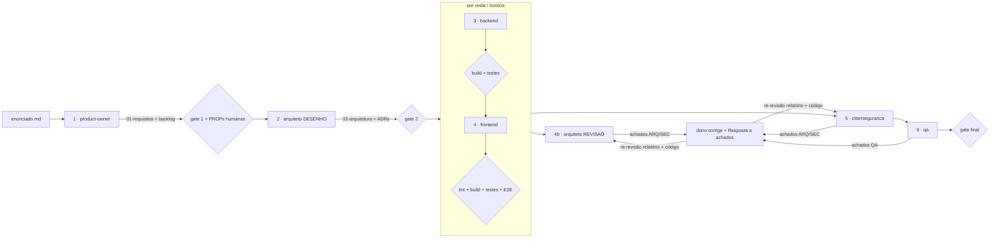

# Esteira SDD por etapas

Este documento descreve **como** o projeto é construído: por etapas, cada uma com um agente dono, um artefato e um gate conferido pelo orquestrador. **O que** é construído está em [../spec.md](../spec.md). **Por que** cada coisa é construída está em [../requisitos/enunciado.md](../requisitos/enunciado.md).

## Por que uma esteira, e não um plano executado de uma vez

A primeira versão do [plano](../plan.md) organizava o trabalho em fases sequenciais executadas por uma única sessão. O desenvolvedor discordou (ver `HL-01` no plano): uma única sessão escreve requisitos, código, testes e revisão, e acaba **revisando o próprio trabalho**. Na esteira, cada papel tem contexto, ferramentas e permissões de escrita próprios. Quem revisa não corrige, e quem corrige não aprova a si mesmo.

## Decisão de abordagem (ADR-0000)

**Contexto.** O mercado de desenvolvimento assistido por IA convergiu para o *Spec-Driven Development* (spec → plano → tarefas → implementação → verificação). Existem três famílias de ferramentas:

1. **Kits de convenção**, como o GitHub Spec Kit e o Kiro: definem artefatos e comandos (`specify`, `plan`, `tasks`, `implement`), mas não definem papéis de revisão independentes.
2. **Frameworks de agentes por papel**, como o BMAD Method: trazem muitos papéis e muito texto genérico, instalados por CLI de terceiros e difíceis de auditar.
3. **Agentes e skills nativos do Claude Code**: `.claude/agents/*.md` com ferramentas, skills e hooks próprios; `.claude/skills/` versionadas no repositório.

**Não há um padrão-ouro único.** Há uma prática dominante (SDD) com várias implementações.

**Decisão.** Uma abordagem híbrida:

- os **artefatos e o fluxo** do SDD no estilo Spec Kit (`spec.md`, `plan.md`, backlog de tarefas, verificação);
- **6 agentes nativos** escritos para este projeto, porque os genéricos não conhecem o enunciado, a stack nem as regras de ouro;
- **skills oficiais vendorizadas**, isto é, copiadas para o repositório, auditadas e fixadas por commit (ver [../../.claude/skills/VENDORED.md](../../.claude/skills/VENDORED.md)), em vez de instalar CLIs de terceiros.

**Alternativas rejeitadas.**

- Spec Kit CLI: acrescenta Python e `uv`, além de modelos genéricos em inglês.
- BMAD: volume e superfície de confiança desproporcionais para 3 endpoints e 2 telas.
- Coleções comunitárias de agentes: sem garantia de procedência.

**Consequências.**

- Mais arquivos de configuração para manter.
- Em troca, cada agente tem limites verificados por hook e cada skill tem procedência registrada.

## Correção registrada: aninhamento de subagentes

Durante a análise, a IA afirmou que "subagentes não podem criar subagentes". **A afirmação estava errada.** A documentação oficial do Claude Code (`code.claude.com/docs/en/sub-agents`) permite aninhar até 3 níveis. O motivo real para o orquestrador ser a **sessão principal**, e não um agente, é outro: subagentes não têm `AskUserQuestion`, e os gates humanos precisam dessa ferramenta. A correção está registrada como `CG` no plano.

## Papéis

| Agente | Arquivo | Modelo · esforço | Escreve em | Não pode |
|---|---|---|---|---|
| Orquestrador (sessão principal) | [skill `/esteira`](../../.claude/skills/esteira/SKILL.md) | Opus 5.5 · high | `status.md`, `docs/ia/`, `plan.md` (HL), `spec.md` (só com `HL-xx`), README raiz, commits autorizados | Implementar no lugar do agente; aprovar gate sem verificação independente |
| `product-owner` | [agente](../../.claude/agents/product-owner.md) | Opus · high | `01-requisitos.md`, `backlog.md` | Decidir arquitetura; editar a spec |
| `arquiteto` | [agente](../../.claude/agents/arquiteto.md) | Opus · high | `02-arquitetura.md`, `docs/adr/`, `revisoes/` | Escrever código |
| `backend` | [agente](../../.claude/agents/backend.md) | **por tarefa**: C1 Haiku · C2 Sonnet · C3 Opus | `backend/`, `database/`, `docs/contratos/`, compose, CI, `deploy/`, `03-backend.md` | Tocar `frontend/`; fazer commit |
| `frontend` | [agente](../../.claude/agents/frontend.md) | **por tarefa**: C1 Haiku · C2 Sonnet · C3 Opus | `frontend/`, `e2e/`, `04-frontend.md` | Alterar a API ou o contrato; fazer commit |
| `ciberseguranca` | [agente](../../.claude/agents/ciberseguranca.md) | Opus · high | `05-seguranca.md`, `revisoes/` | Corrigir código |
| `qa` | [agente](../../.claude/agents/qa.md) | Sonnet · high | `06-qa.md`, `revisoes/`, `evidencias/` | Corrigir código ou documentação de outro dono |
| `verificador` | [agente](../../.claude/agents/verificador.md) | Haiku · low | nada (só executa comandos de gate) | Editar arquivos; interpretar ou corrigir falhas |

O custo acompanha a dificuldade: análise e revisão rodam no Opus, trabalho mecânico no Haiku (1/40 do preço do Opus), e cada escalonamento fica registrado. A regra completa, os preços e as alternativas descartadas estão em [ADR-0001](../adr/0001-roteamento-de-modelos.md).

Os limites **não dependem só do prompt**:

- [`guard-paths.sh`](../../.claude/hooks/guard-paths.sh) bloqueia a escrita fora dos caminhos do agente;
- [`guard-bash.sh`](../../.claude/hooks/guard-bash.sh) bloqueia `git` que altera histórico ou árvore, leitura de `.env`, `curl | sh` e instalação global.

Os dois são hooks `PreToolUse` declarados no frontmatter de cada agente. Eles só valem depois que a pasta do projeto é marcada como confiável no Claude Code.

## Fluxo



## Identificadores

| Prefixo | Significado | Onde nasce |
|---|---|---|
| `ENU-Lxxx` | Linha do enunciado | `requisitos/enunciado.md` |
| `RF-xx` / `RNF-xx` / `ENT-xx` | Requisito funcional, não funcional e de entrega | `01-requisitos.md` |
| `EP-xx` / `US-xx` / `T-xx.n` | Épico, história e tarefa (1 tarefa = 1 commit) | `backlog.md` |
| `RN-xx` / `CA-xx` | Regra de negócio e critério de aceite | `spec.md` |
| `D-xx` | Decisão da proposta inicial da IA | `plan.md` |
| `HL-xx` / `CG-xx` | Decisão humana e correção da IA | `plan.md` (seção Human-in-the-Loop) |
| `PROP-xx` | Proposta de alteração da spec, aguardando decisão humana | relatório do agente que a levantou |
| `ADR-nnnn` | Registro de decisão de arquitetura | `docs/adr/` |
| `ARQ-xx` / `SEC-xx` / `QA-xx` | Achado de revisão | `revisoes/`, `05-seguranca.md`, `06-qa.md` |

## Ciclo de um achado

`Aberto` → dono corrige e responde → revisor confere relatório **e** código → `Resolvido` | `Parcial` | `Não resolvido`. Depois de 2 rodadas sem solução, o achado é escalado ao desenvolvedor, que decide entre corrigir de outro jeito, aceitar o risco ou mudar a spec. A decisão vira `HL-xx`.

## Artefatos

| Arquivo | Dono |
|---|---|
| [status.md](status.md) | orquestrador |
| [../ia/diario.md](../ia/diario.md), `prompts.md`, `roteiro-video.md` | orquestrador (`HL-07`) |
| `01-requisitos.md`, `backlog.md` | product-owner |
| `02-arquitetura.md` | arquiteto |
| `03-backend.md` | backend |
| `04-frontend.md` | frontend |
| `05-seguranca.md` | ciberseguranca |
| `06-qa.md` | qa |
| `revisoes/` | revisores |
| `evidencias/` | qa |
| [templates/](templates/) | orquestrador |

## Como usar

```text
/esteira status        # onde estamos
/esteira               # executa o próximo passo
/esteira US-03         # backend + frontend de uma história
/esteira achados       # rodada de correção
```
