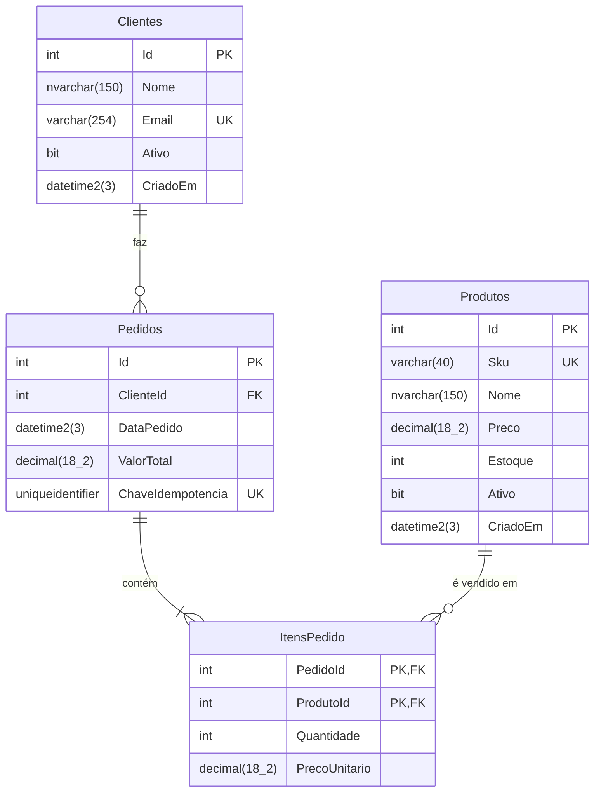

# Especificação — Mini Gestão de Pedidos

| | |
|---|---|
| **Projeto** | Teste técnico Joya Solutions — Mini Gestão de Pedidos |
| **Stack** | .NET 8 (C# 12) · Angular 19 Standalone · SQL Server 2022 · Docker Compose |
| **Status** | Especificação aprovada para planejamento (nenhum código de implementação escrito) |
| **Documentos relacionados** | [plan.md](plan.md) · [CLAUDE.md](../CLAUDE.md) |

> **Como ler este documento.** Cada regra tem um identificador estável (`RN-xx`), cada critério de aceite também (`CA-xx`). Código, testes e commits referenciam esses IDs. A seção 9 liga cada requisito do enunciado à regra, ao critério de aceite e ao tipo de teste que o cobre.

---

## 1. Objetivo de negócio

Permitir que a operação comercial **registre pedidos de clientes com baixa de estoque confiável** e **consulte o histórico de vendas** com filtros, além de identificar **os clientes que mais compraram** em um período.

O valor central da feature não é a sofisticação da regra, e sim a **confiabilidade do registro**:

1. Nunca vender o que não existe em estoque, mesmo com várias pessoas vendendo o mesmo produto ao mesmo tempo.
2. Nunca alterar retroativamente o valor de uma venda quando o preço de tabela do produto mudar.
3. Nunca gravar um pedido "pela metade" (pedido sem itens, itens sem baixa de estoque, baixa sem pedido).

## 2. Escopo

### 2.1 Dentro do escopo

| # | Capacidade | Origem |
|---|---|---|
| E1 | Criar pedido com itens (`POST /pedidos`) | Enunciado, Parte 3 |
| E2 | Listar pedidos com filtro por cliente e período, paginado (`GET /pedidos`) | Enunciado, Parte 3 |
| E3 | Relatório dos 5 clientes com maior valor total no período (`GET /relatorios/top-clientes`) | Enunciado, Parte 3 |
| E4 | Consultar um pedido com seus itens (`GET /pedidos/{id}`) | **Derivado** — alvo do cabeçalho `Location` do `201 Created` |
| E5 | Listar clientes e produtos para os seletores da tela (`GET /clientes`, `GET /produtos`) | **Derivado** — a tela de criação não funciona sem eles |
| E6 | Tela de listagem com filtros e tela de criação de pedido (Angular) | Enunciado, Parte 3 |
| E7 | Health checks (`/health/live`, `/health/ready`) | **Derivado** — orquestração do Docker Compose |

Os itens E4, E5 e E7 não estão no enunciado. São o mínimo necessário para que os itens obrigatórios funcionem de ponta a ponta e estão marcados como derivados para deixar claro que foram uma decisão, não um requisito.

### 2.2 Fora do escopo (decisão explícita)

- Autenticação e autorização. A API é aberta; em produção ficaria atrás de um gateway com OIDC.
- CRUD de clientes e produtos. Os dados vêm da carga inicial (`database/`).
- Edição, cancelamento ou exclusão de pedido. Pedido é um fato imutável (ver RN-12). Um cancelamento exigiria estorno de estoque e status, e não foi pedido.
- Reserva de estoque, carrinho, pagamento, frete, impostos, descontos, multi-moeda.
- Tela para o relatório de top clientes (o enunciado exige apenas o endpoint).

## 3. Glossário

| Termo | Definição |
|---|---|
| **Cliente** | Pessoa ou empresa que compra. Pode estar ativo ou inativo. |
| **Produto** | Item vendável, com preço de tabela e quantidade em estoque. |
| **Pedido** | Registro imutável de uma venda para um cliente em um instante. |
| **Item de pedido** | Linha do pedido: um produto, uma quantidade e o preço unitário praticado. |
| **Preço de tabela** | `Produtos.Preco` — preço vigente, pode mudar a qualquer momento. |
| **Preço praticado** | `ItensPedido.PrecoUnitario` — cópia do preço de tabela no instante da venda. Nunca muda. |
| **Baixa de estoque** | Decremento de `Produtos.Estoque` pela quantidade vendida. |
| **Período** | Intervalo de datas `[dataInicio, dataFim]`, inclusivo nas duas pontas, em UTC. |

A linguagem do domínio é **português** (as tabelas e rotas do enunciado já são). Sufixos técnicos ficam em inglês (`Service`, `Repository`, `Controller`, `Request`, `Response`, `Validator`).

## 4. Regras de negócio

### 4.1 Validação estrutural do pedido (falha → `400`)

| ID | Regra |
|---|---|
| **RN-01** | Um pedido tem **no mínimo 1 e no máximo 50 itens**. Pedido sem itens (lista ausente, nula ou vazia) é rejeitado. |
| **RN-02** | A quantidade de cada item é um **inteiro entre 1 e 10 000**. |
| **RN-03** | Um mesmo produto **não pode aparecer em dois itens** do mesmo pedido. A API rejeita em vez de somar silenciosamente, para que o contrato seja explícito e a PK `(PedidoId, ProdutoId)` seja a tradução direta da regra. |
| **RN-04** | `clienteId` e `produtoId` são inteiros positivos. O corpo **não aceita preço**: qualquer campo de preço enviado é ignorado (ver RN-09). |

### 4.2 Validação de negócio (falha → `422` ou `409`)

| ID | Regra | Falha |
|---|---|---|
| **RN-05** | O cliente informado **deve existir**. | `422 CLIENTE_NAO_ENCONTRADO` |
| **RN-06** | O cliente deve estar **ativo** (`Clientes.Ativo = 1`). | `422 CLIENTE_INATIVO` |
| **RN-07** | Todo produto informado deve **existir e estar ativo**. A resposta lista todos os `produtoId` inválidos de uma vez. | `422 PRODUTO_NAO_ENCONTRADO` |
| **RN-08** | Deve haver **estoque suficiente** para todos os itens **no instante da gravação**. A resposta lista todos os itens sem estoque, com a quantidade disponível. | `409 ESTOQUE_INSUFICIENTE` |

**Ordem de avaliação** (determinística, coberta por teste): RN-01…04 → RN-05 → RN-06 → RN-07 → RN-08. A primeira categoria que falha encerra o processamento.

### 4.3 Atomicidade do estoque sob concorrência (RN-08, detalhe normativo)

A verificação e a baixa de estoque são **uma única instrução atômica por produto**. É proibido implementar "ler o estoque, comparar em memória, depois gravar" (*check-then-act*), porque duas requisições simultâneas leriam o mesmo saldo e ambas passariam.

```sql
UPDATE dbo.Produtos
SET    Estoque = Estoque - @quantidade
OUTPUT inserted.Preco                      -- preço capturado na mesma instrução da baixa
WHERE  Id = @produtoId
  AND  Ativo = 1
  AND  Estoque >= @quantidade;             -- 0 linhas afetadas = sem estoque (ou produto inativado)
```

Propriedades exigidas:

1. **Sem venda acima do estoque.** O predicado `Estoque >= @quantidade` é reavaliado pelo SQL Server sob o lock de atualização da linha; duas transações nunca debitam o mesmo saldo.
2. **Tudo ou nada (RN-10).** Todas as baixas, o `INSERT` do pedido e os `INSERT`s dos itens ocorrem em **uma única transação**. Se qualquer item falhar, nada é persistido e nenhum estoque é debitado.
3. **Ordem de lock determinística.** Os itens são processados em ordem crescente de `ProdutoId`, de modo que dois pedidos com os mesmos produtos nunca adquirem locks em ordens opostas (prevenção de deadlock).
4. **Diagnóstico completo.** Em caso de falha, a transação tenta a baixa de todos os itens antes de desfazer, para devolver a lista completa de itens sem estoque (e não apenas o primeiro).
5. **Última linha de defesa.** `CHECK (Estoque >= 0)` na tabela garante o invariante mesmo se algum código futuro contornar a regra.

Nível de isolamento: `READ COMMITTED` com `READ_COMMITTED_SNAPSHOT ON`. Leitores (listagem, relatório) não bloqueiam nem são bloqueados por quem está vendendo; a instrução `UPDATE` continua lendo a versão corrente da linha sob lock, então a garantia acima se mantém.

### 4.4 Regras de gravação

| ID | Regra |
|---|---|
| **RN-09** | **Imutabilidade do preço praticado.** `ItensPedido.PrecoUnitario` recebe o valor de `Produtos.Preco` lido **na mesma instrução** que debita o estoque (cláusula `OUTPUT`). O cliente da API não informa preço. Alterações posteriores em `Produtos.Preco` não afetam pedidos existentes. Não existe operação que atualize `PrecoUnitario`. |
| **RN-10** | **Atomicidade.** Pedido, itens e baixas de estoque são gravados em uma única transação. |
| **RN-11** | **Valor total.** `Pedidos.ValorTotal = Σ (Quantidade × PrecoUnitario)` dos itens, calculado pelo servidor e gravado junto com o pedido. Aritmética em `decimal`, sem `double`/`float` em nenhuma camada. |
| **RN-12** | **Pedido imutável.** Após criado, pedido e itens não são alterados nem removidos (não há endpoint de `PUT`/`PATCH`/`DELETE`; o login da aplicação não precisa de `DELETE`). É o que torna segura a desnormalização de `ValorTotal`. |
| **RN-13** | **Data do pedido.** `DataPedido` é atribuída pelo servidor (relógio injetável, `TimeProvider`), em **UTC**, com precisão de milissegundos, truncada antes de gravar, de modo que o `201` e as leituras posteriores devolvem o mesmo instante (`HL-20`). O cliente não informa data. |
| **RN-14** | **Idempotência (opcional para o chamador).** Se o cabeçalho `Idempotency-Key` (UUID) for enviado e já existir um pedido com essa chave, a API **não cria outro pedido nem debita estoque de novo**: devolve o pedido original. Protege contra duplo clique e *retry* após timeout de rede. **Corrida (`HL-14`):** se duas requisições com a mesma chave chegarem ao mesmo tempo e a gravação violar `UX_Pedidos_ChaveIdempotencia`, a transação da segunda é desfeita (o estoque volta) e a API devolve `200` com o pedido original e `Idempotent-Replayed: true`. |

### 4.5 Regras de consulta

| ID | Regra |
|---|---|
| **RN-15** | **Período.** `dataInicio` e `dataFim` são datas (`yyyy-MM-dd`) **inclusivas**, interpretadas em **UTC**. Internamente o filtro é sempre o intervalo semiaberto `DataPedido >= dataInicio AND DataPedido < dataFim + 1 dia` (sargável; nunca `YEAR()`/`CAST()` sobre a coluna). `dataInicio > dataFim` → `400`. |
| **RN-16** | **Listagem.** Filtros opcionais e combináveis (`clienteId`, `dataInicio`, `dataFim`). Ordenação fixa `DataPedido DESC, Id DESC` (o desempate por `Id` torna a paginação estável). `page ≥ 1` (padrão 1); `pageSize` entre 1 e 100 (padrão 20). Filtrar por cliente inexistente devolve `200` com lista vazia — é um filtro, não um recurso. |
| **RN-17** | **Top clientes.** Período **obrigatório**. Retorna **até 5** clientes, ordenados por valor total `DESC`; empate resolvido por `clienteId ASC` (resultado determinístico). Agrupamento por **`ClienteId`**, nunca por nome (clientes homônimos são clientes diferentes). Clientes sem pedido no período não aparecem. Clientes inativos aparecem (é histórico). |

## 5. Contratos da API REST

### 5.1 Convenções gerais

| Aspecto | Convenção |
|---|---|
| Base | Rotas na raiz, exatamente como no enunciado (`/pedidos`, `/relatorios/top-clientes`). No Docker, o Nginx do frontend expõe a API em `/api/*` (mesma origem, sem CORS). |
| Formato | `application/json; charset=utf-8`, propriedades em `camelCase`. |
| Dinheiro | Número JSON com 2 casas (`149.90`), `decimal` no servidor. |
| Datas | Instantes: ISO 8601 UTC com sufixo `Z` (`2026-11-13T14:32:07.123Z`). Filtros: data pura `yyyy-MM-dd`. |
| Erros | **RFC 9457 Problem Details**, `Content-Type: application/problem+json`, com as extensões `code` (estável, legível por máquina) e `traceId`. |
| Cancelamento | Toda requisição propaga `CancellationToken` até o banco. |
| Documentação | OpenAPI/Swagger em `/swagger` (Development, Docker e ambiente de teste de integração). O documento publicado fica versionado em `docs/contratos/openapi.json` e é conferido por teste no backend e no frontend ([ADR-0005](adr/0005-contrato-openapi-versionado.md), `HL-21`). |

**Cabeçalhos**

| Cabeçalho | Direção | Uso |
|---|---|---|
| `Content-Type: application/json` | requisição | Obrigatório no `POST`. Outro tipo → `415`. |
| `Idempotency-Key: <uuid>` | requisição | Opcional no `POST /pedidos` (RN-14). Valor que não é UUID → `400`. |
| `Location: /pedidos/{id}` | resposta | No `201 Created`. |
| `Idempotent-Replayed: true` | resposta | Presente quando a resposta é a reapresentação de um pedido já criado com a mesma chave. |
| `Content-Type: application/problem+json` | resposta | Em toda resposta de erro. |

**Catálogo de erros**

| HTTP | `code` | Quando |
|---|---|---|
| 400 | `VALIDACAO` | Corpo malformado, tipos inválidos, RN-01…04, parâmetros de consulta inválidos, RN-15 |
| 404 | `PEDIDO_NAO_ENCONTRADO` | `GET /pedidos/{id}` com id inexistente |
| 409 | `ESTOQUE_INSUFICIENTE` | RN-08 |
| 413 | — | Corpo da requisição acima do limite (RNF-06, `HL-12`) |
| 415 | — | `Content-Type` não suportado |
| 422 | `CLIENTE_NAO_ENCONTRADO` | RN-05 |
| 422 | `CLIENTE_INATIVO` | RN-06 |
| 422 | `PRODUTO_NAO_ENCONTRADO` | RN-07 |
| 429 | `LIMITE_DE_TAXA` | Limite de requisições por IP no `POST /pedidos` excedido (RNF-06, `HL-12`). Traz `Retry-After` |
| 500 | `ERRO_INTERNO` | Falha não prevista. Nunca expõe stack trace nem mensagem de exceção. |

**Por que `422` e não `404` para cliente inexistente no `POST`.** `404` significa que o recurso da URL (`/pedidos`) não existe, o que é falso. O corpo é sintaticamente válido, mas referencia uma entidade que não existe: é exatamente o caso de `422 Unprocessable Content`. **Por que `409` para estoque.** A requisição é válida e pode ter sucesso mais tarde sem nenhuma alteração; ela conflita com o estado atual do recurso — semântica de `409 Conflict`.

### 5.2 `POST /pedidos` — criar pedido

**Requisição**

```http
POST /pedidos HTTP/1.1
Content-Type: application/json
Idempotency-Key: 7f9c2a4e-1b6d-4c3a-9e2f-5a8b7c6d4e3f

{
  "clienteId": 7,
  "itens": [
    { "produtoId": 12, "quantidade": 2 },
    { "produtoId": 31, "quantidade": 2 }
  ]
}
```

Schema da requisição (propriedades desconhecidas são ignoradas, nunca interpretadas — ver RN-04):

```json
{
  "type": "object",
  "required": ["clienteId", "itens"],
  "properties": {
    "clienteId": { "type": "integer", "minimum": 1 },
    "itens": {
      "type": "array",
      "minItems": 1,
      "maxItems": 50,
      "items": {
        "type": "object",
        "required": ["produtoId", "quantidade"],
        "properties": {
          "produtoId":  { "type": "integer", "minimum": 1 },
          "quantidade": { "type": "integer", "minimum": 1, "maximum": 10000 }
        }
      }
    }
  }
}
```

**`201 Created`**

```http
HTTP/1.1 201 Created
Location: /pedidos/1042
Content-Type: application/json; charset=utf-8

{
  "id": 1042,
  "clienteId": 7,
  "clienteNome": "Mercado Bom Preço Ltda",
  "dataPedido": "2026-11-13T14:32:07.123Z",
  "valorTotal": 359.70,
  "itens": [
    { "produtoId": 12, "produtoNome": "Teclado Mecânico ABNT2", "quantidade": 2, "precoUnitario": 149.90, "subtotal": 299.80 },
    { "produtoId": 31, "produtoNome": "Mouse Pad Grande",       "quantidade": 2, "precoUnitario": 29.95,  "subtotal": 59.90 }
  ]
}
```

Schema `PedidoResponse`:

```json
{
  "type": "object",
  "required": ["id", "clienteId", "clienteNome", "dataPedido", "valorTotal", "itens"],
  "properties": {
    "id":          { "type": "integer" },
    "clienteId":   { "type": "integer" },
    "clienteNome": { "type": "string" },
    "dataPedido":  { "type": "string", "format": "date-time" },
    "valorTotal":  { "type": "number", "multipleOf": 0.01, "minimum": 0 },
    "itens": {
      "type": "array",
      "minItems": 1,
      "items": {
        "type": "object",
        "required": ["produtoId", "produtoNome", "quantidade", "precoUnitario", "subtotal"],
        "properties": {
          "produtoId":     { "type": "integer" },
          "produtoNome":   { "type": "string" },
          "quantidade":    { "type": "integer", "minimum": 1 },
          "precoUnitario": { "type": "number", "multipleOf": 0.01, "minimum": 0 },
          "subtotal":      { "type": "number", "multipleOf": 0.01, "minimum": 0 }
        }
      }
    }
  }
}
```

**`200 OK` (reapresentação idempotente)** — mesmo corpo do `201`, com `Idempotent-Replayed: true` e `Location`. Limitação documentada: a API não compara o corpo da nova requisição com o original; a chave identifica a intenção.

**`400 Bad Request`** — validação estrutural

```json
{
  "type": "/erros/validacao",
  "title": "Requisição inválida",
  "status": 400,
  "code": "VALIDACAO",
  "traceId": "00-4bf92f3577b34da6a3ce929d0e0e4736-00f067aa0ba902b7-00",
  "errors": {
    "itens": ["O pedido deve ter ao menos um item."],
    "itens[1].quantidade": ["A quantidade deve estar entre 1 e 10000."]
  }
}
```

**`422 Unprocessable Content`** — cliente ou produto

```json
{
  "type": "/erros/produto-nao-encontrado",
  "title": "Produto inexistente ou inativo",
  "status": 422,
  "detail": "Os produtos 98 e 99 não existem ou estão inativos.",
  "code": "PRODUTO_NAO_ENCONTRADO",
  "traceId": "00-…",
  "produtoIds": [98, 99]
}
```

**`409 Conflict`** — estoque insuficiente

```json
{
  "type": "/erros/estoque-insuficiente",
  "title": "Estoque insuficiente",
  "status": 409,
  "detail": "Não há estoque suficiente para 1 item do pedido.",
  "code": "ESTOQUE_INSUFICIENTE",
  "traceId": "00-…",
  "itens": [
    { "produtoId": 12, "produtoNome": "Teclado Mecânico ABNT2", "quantidadeSolicitada": 2, "estoqueDisponivel": 1 }
  ]
}
```

`estoqueDisponivel` é informativo: é lido depois do rollback e pode já ter mudado quando o usuário tentar de novo.

### 5.3 `GET /pedidos` — listar pedidos

| Parâmetro | Tipo | Obrigatório | Padrão | Regra |
|---|---|---|---|---|
| `clienteId` | inteiro ≥ 1 | não | — | Filtra por cliente |
| `dataInicio` | `yyyy-MM-dd` | não | — | Inclusivo, UTC |
| `dataFim` | `yyyy-MM-dd` | não | — | Inclusivo, UTC; `≥ dataInicio` |
| `page` | inteiro ≥ 1 | não | `1` | |
| `pageSize` | inteiro 1–100 | não | `20` | |

```http
GET /pedidos?clienteId=7&dataInicio=2026-01-01&dataFim=2026-12-31&page=1&pageSize=20 HTTP/1.1
```

**`200 OK`**

```json
{
  "items": [
    {
      "id": 1042,
      "clienteId": 7,
      "clienteNome": "Mercado Bom Preço Ltda",
      "dataPedido": "2026-11-13T14:32:07.123Z",
      "valorTotal": 359.70,
      "quantidadeItens": 2
    }
  ],
  "page": 1,
  "pageSize": 20,
  "totalItems": 137,
  "totalPages": 7
}
```

Schema `PaginaResponse<PedidoResumoResponse>`:

```json
{
  "type": "object",
  "required": ["items", "page", "pageSize", "totalItems", "totalPages"],
  "properties": {
    "items": {
      "type": "array",
      "items": {
        "type": "object",
        "required": ["id", "clienteId", "clienteNome", "dataPedido", "valorTotal", "quantidadeItens"],
        "properties": {
          "id":              { "type": "integer" },
          "clienteId":       { "type": "integer" },
          "clienteNome":     { "type": "string" },
          "dataPedido":      { "type": "string", "format": "date-time" },
          "valorTotal":      { "type": "number", "multipleOf": 0.01 },
          "quantidadeItens": { "type": "integer", "minimum": 1 }
        }
      }
    },
    "page":       { "type": "integer", "minimum": 1 },
    "pageSize":   { "type": "integer", "minimum": 1, "maximum": 100 },
    "totalItems": { "type": "integer", "minimum": 0 },
    "totalPages": { "type": "integer", "minimum": 0 }
  }
}
```

- A paginação viaja no corpo (envelope), não em cabeçalhos: é o que o frontend consome e evita configurar `Access-Control-Expose-Headers`.
- `quantidadeItens` é o número de linhas do pedido (não a soma das quantidades).
- Página além do fim → `200` com `items: []` e os totais corretos.
- **`400`**: `page < 1`, `pageSize` fora de 1–100, data em formato inválido, `dataInicio > dataFim`.
- A listagem não traz os itens (evita N+1 e payload grande); o detalhe está em `GET /pedidos/{id}`.

### 5.4 `GET /relatorios/top-clientes` — ranking por valor

| Parâmetro | Tipo | Obrigatório | Regra |
|---|---|---|---|
| `dataInicio` | `yyyy-MM-dd` | **sim** | Inclusivo, UTC |
| `dataFim` | `yyyy-MM-dd` | **sim** | Inclusivo, UTC; `≥ dataInicio` |

```http
GET /relatorios/top-clientes?dataInicio=2026-01-01&dataFim=2026-12-31 HTTP/1.1
```

**`200 OK`** — array com 0 a 5 elementos, já ordenado

```json
[
  { "posicao": 1, "clienteId": 3,  "clienteNome": "Atacado Central S.A.",   "valorTotal": 184250.40, "quantidadePedidos": 61 },
  { "posicao": 2, "clienteId": 7,  "clienteNome": "Mercado Bom Preço Ltda", "valorTotal": 97310.00,  "quantidadePedidos": 44 },
  { "posicao": 3, "clienteId": 15, "clienteNome": "João da Silva",          "valorTotal": 51020.75,  "quantidadePedidos": 12 },
  { "posicao": 4, "clienteId": 22, "clienteNome": "João da Silva",          "valorTotal": 50880.10,  "quantidadePedidos": 19 },
  { "posicao": 5, "clienteId": 9,  "clienteNome": "Padaria Estrela ME",     "valorTotal": 33400.00,  "quantidadePedidos": 27 }
]
```

O exemplo traz de propósito dois clientes homônimos (ids 15 e 22) em linhas separadas: é o comportamento exigido pela RN-17 e o defeito central da query da Parte 4.

Schema:

```json
{
  "type": "array",
  "maxItems": 5,
  "items": {
    "type": "object",
    "required": ["posicao", "clienteId", "clienteNome", "valorTotal", "quantidadePedidos"],
    "properties": {
      "posicao":           { "type": "integer", "minimum": 1, "maximum": 5 },
      "clienteId":         { "type": "integer" },
      "clienteNome":       { "type": "string" },
      "valorTotal":        { "type": "number", "multipleOf": 0.01 },
      "quantidadePedidos": { "type": "integer", "minimum": 1 }
    }
  }
}
```

**`400`**: parâmetro ausente, formato inválido, `dataInicio > dataFim`. Período sem vendas → `200` com `[]`.

### 5.5 Endpoints de apoio (derivados)

| Endpoint | Resposta | Observação |
|---|---|---|
| `GET /pedidos/{id}` | `200` `PedidoResponse` · `404 PEDIDO_NAO_ENCONTRADO` | Alvo do `Location`; usado no detalhe do pedido |
| `GET /clientes?ativo=true` | `200` `[{ "id", "nome", "ativo" }]` ordenado por nome | Alimenta o seletor de cliente |
| `GET /produtos?ativo=true` | `200` `[{ "id", "sku", "nome", "preco", "estoque" }]` ordenado por nome | Alimenta o seletor de produto. `preco` e `estoque` são **informativos** na tela; a verdade é decidida no `POST` |
| `GET /health/live` | `200` | Processo no ar |
| `GET /health/ready` | `200` / `503` | Verifica conexão com o SQL Server |

O parâmetro `ativo` é opcional (`true`/`false`). Sem ele, a resposta traz todos os registros; valor que não é booleano → `400 VALIDACAO` (`HL-18`).

Sem paginação em clientes e produtos: a carga de exemplo tem dezenas de linhas. Com catálogo real, seria busca incremental (typeahead) com paginação — registrado como evolução, não implementado.

## 6. Modelo de dados

Banco `JoyaPedidos`, schema `dbo`, SQL Server 2022. Os scripts em `database/` são a **única fonte de verdade do schema** (o EF Core mapeia o schema existente; não há migrations).

### 6.1 Diagrama



### 6.2 DDL de referência

```sql
SET ANSI_NULLS ON;
SET QUOTED_IDENTIFIER ON;   -- obrigatório para índice filtrado; o sqlcmd liga com -I
GO

CREATE TABLE dbo.Clientes (
    Id        INT IDENTITY(1,1) NOT NULL,
    Nome      NVARCHAR(150)     NOT NULL,
    Email     VARCHAR(254)      NOT NULL,
    Ativo     BIT               NOT NULL CONSTRAINT DF_Clientes_Ativo    DEFAULT (1),
    CriadoEm  DATETIME2(3)      NOT NULL CONSTRAINT DF_Clientes_CriadoEm DEFAULT (SYSUTCDATETIME()),
    CONSTRAINT PK_Clientes            PRIMARY KEY CLUSTERED (Id),
    CONSTRAINT UQ_Clientes_Email      UNIQUE (Email),
    CONSTRAINT CK_Clientes_Nome_Vazio CHECK (LEN(LTRIM(RTRIM(Nome))) > 0)
);

CREATE TABLE dbo.Produtos (
    Id        INT IDENTITY(1,1) NOT NULL,
    Sku       VARCHAR(40)       NOT NULL,
    Nome      NVARCHAR(150)     NOT NULL,
    Preco     DECIMAL(18,2)     NOT NULL,
    Estoque   INT               NOT NULL,
    Ativo     BIT               NOT NULL CONSTRAINT DF_Produtos_Ativo    DEFAULT (1),
    CriadoEm  DATETIME2(3)      NOT NULL CONSTRAINT DF_Produtos_CriadoEm DEFAULT (SYSUTCDATETIME()),
    CONSTRAINT PK_Produtos              PRIMARY KEY CLUSTERED (Id),
    CONSTRAINT UQ_Produtos_Sku          UNIQUE (Sku),
    CONSTRAINT CK_Produtos_Preco        CHECK (Preco >= 0),
    CONSTRAINT CK_Produtos_Estoque      CHECK (Estoque >= 0),   -- última linha de defesa da RN-08
    CONSTRAINT CK_Produtos_Nome_Vazio   CHECK (LEN(LTRIM(RTRIM(Nome))) > 0)
);

CREATE TABLE dbo.Pedidos (
    Id                 INT IDENTITY(1,1) NOT NULL,
    ClienteId          INT               NOT NULL,
    DataPedido         DATETIME2(3)      NOT NULL CONSTRAINT DF_Pedidos_DataPedido DEFAULT (SYSUTCDATETIME()),
    ValorTotal         DECIMAL(18,2)     NOT NULL,
    ChaveIdempotencia  UNIQUEIDENTIFIER  NULL,
    CONSTRAINT PK_Pedidos            PRIMARY KEY CLUSTERED (Id),
    CONSTRAINT FK_Pedidos_Clientes   FOREIGN KEY (ClienteId) REFERENCES dbo.Clientes (Id),
    CONSTRAINT CK_Pedidos_ValorTotal CHECK (ValorTotal >= 0)
);

CREATE TABLE dbo.ItensPedido (
    PedidoId       INT           NOT NULL,
    ProdutoId      INT           NOT NULL,
    Quantidade     INT           NOT NULL,
    PrecoUnitario  DECIMAL(18,2) NOT NULL,
    CONSTRAINT PK_ItensPedido            PRIMARY KEY CLUSTERED (PedidoId, ProdutoId),   -- RN-03
    CONSTRAINT FK_ItensPedido_Pedidos    FOREIGN KEY (PedidoId)  REFERENCES dbo.Pedidos  (Id),
    CONSTRAINT FK_ItensPedido_Produtos   FOREIGN KEY (ProdutoId) REFERENCES dbo.Produtos (Id),
    CONSTRAINT CK_ItensPedido_Quantidade CHECK (Quantidade > 0),
    CONSTRAINT CK_ItensPedido_Preco      CHECK (PrecoUnitario >= 0)
);
```

Todas as FKs usam `ON DELETE NO ACTION` (padrão): não existe exclusão em cascata de histórico de vendas.

### 6.3 Índices

O SQL Server **não cria índice automaticamente para colunas de FK**. Cada índice abaixo existe por causa de uma consulta concreta.

```sql
-- GET /pedidos?clienteId=… (com ou sem período): seek por cliente, já na ordem da listagem.
CREATE NONCLUSTERED INDEX IX_Pedidos_ClienteId_DataPedido
    ON dbo.Pedidos (ClienteId, DataPedido DESC, Id DESC)
    INCLUDE (ValorTotal);

-- GET /pedidos por período (ou sem filtro) e GET /relatorios/top-clientes:
-- range seek em DataPedido, cobrindo ClienteId e ValorTotal (sem key lookup).
CREATE NONCLUSTERED INDEX IX_Pedidos_DataPedido
    ON dbo.Pedidos (DataPedido DESC, Id DESC)
    INCLUDE (ClienteId, ValorTotal);

-- RN-14: no máximo um pedido por chave de idempotência; NULLs ficam fora do índice.
CREATE UNIQUE NONCLUSTERED INDEX UX_Pedidos_ChaveIdempotencia
    ON dbo.Pedidos (ChaveIdempotencia)
    WHERE ChaveIdempotencia IS NOT NULL;

-- Suporte à FK ItensPedido → Produtos (validação de integridade e consultas por produto).
CREATE NONCLUSTERED INDEX IX_ItensPedido_ProdutoId
    ON dbo.ItensPedido (ProdutoId);
```

| Consulta | Índice usado |
|---|---|
| Itens de um pedido (`GET /pedidos/{id}`, contagem de itens na listagem, join da Parte 4) | `PK_ItensPedido` clusterizado por `PedidoId` — cobre tudo, não precisa de índice adicional |
| Baixa de estoque por produto | `PK_Produtos` (seek por `Id`) |
| Cliente por id | `PK_Clientes` |

### 6.4 Decisões de modelagem

| Decisão | Justificativa | Alternativa descartada |
|---|---|---|
| PK composta `(PedidoId, ProdutoId)` em `ItensPedido`, clusterizada | Traduz a RN-03 em constraint; itens são sempre lidos pelo pedido, então ficam fisicamente contíguos; dispensa um índice extra em `PedidoId` | `Id IDENTITY` substituto + `UNIQUE (PedidoId, ProdutoId)` + índice em `PedidoId`: três estruturas para o mesmo efeito |
| `Pedidos.ValorTotal` desnormalizado | Listagem e ranking leem só `Pedidos` (um índice cobre tudo); seguro porque o pedido é imutável (RN-12) | Calcular `SUM` de itens em toda consulta: join e agregação a cada página listada |
| `DATETIME2(3)` em UTC | Milissegundos bastam; UTC elimina ambiguidade de horário de verão e de fuso do servidor | `DATETIMEOFFSET`: 2 bytes a mais por linha sem ganho quando tudo é UTC |
| `DECIMAL(18,2)` para dinheiro | Aritmética exata | `MONEY` (arredondamento em divisão), `FLOAT` (inexato) |
| `Clientes.Nome` **sem** unicidade | Homônimos existem; a identidade é o `Id` (e o e-mail é único) | — |
| Sem coluna `Status` em `Pedidos` | Não há ciclo de vida no escopo; adicionar status sem transições seria dado morto | — |
| Sem gatilhos | A imutabilidade é garantida pela ausência de operação de escrita e pelas permissões do login; gatilho em `Produtos` ainda impediria o `OUTPUT` direto da RN-08 | Gatilho `INSTEAD OF UPDATE` em `ItensPedido` |

### 6.5 Segurança de acesso ao banco

| Login | Uso | Permissões |
|---|---|---|
| `sa` | Apenas o contêiner `db-init` (criação do banco e carga) | — |
| `joya_app` | API .NET | `SELECT`, `INSERT`, `UPDATE` no schema `dbo` (sem `DELETE`, sem DDL) |
| `claude_mcp` | Servidor MCP usado pelo Claude Code | `db_datareader`, `VIEW DEFINITION`, `SHOWPLAN`, `VIEW DATABASE STATE` — somente leitura e diagnóstico |

## 7. Requisitos não funcionais

| ID | Requisito |
|---|---|
| **RNF-01** | **Integridade.** Nenhum cenário de concorrência resulta em estoque negativo ou venda acima do saldo (verificado por teste de integração com requisições paralelas). |
| **RNF-02** | **Consultas indexadas (`HL-17`).** Listagem **com filtro** e ranking resolvem com *index seek* nos índices da seção 6.3, sem *key lookup*. A listagem **sem filtro** é um *scan* ordenado de `IX_Pedidos_DataPedido` limitado por `TOP`, e o total dela é um *scan* do índice mais estreito de `Pedidos`. Nenhuma consulta com N+1. |
| **RNF-03** | **Build limpo.** Zero warnings (`TreatWarningsAsErrors`), nullable reference types habilitado, analisadores do .NET ativos. |
| **RNF-04** | **Um comando.** `docker compose up` sobe banco (com schema e carga), API e frontend sem passo manual e sem arquivo `.env` obrigatório. Subir de novo não falha nem duplica a carga (scripts idempotentes). Num clone limpo, `docker compose up`, sem flags, constrói as imagens e sobe tudo. `--build` só é necessário para reconstruir depois de mudar o código, e o README usa este mesmo texto (`HL-15`). |
| **RNF-05** | **Observabilidade mínima.** Log estruturado em console; todo erro traz `traceId`; health checks de *liveness* e *readiness*. |
| **RNF-06** | **Segurança básica.** Somente consultas parametrizadas; nenhuma mensagem de exceção ou stack trace exposta; contêineres da API e do frontend sem root; a aplicação não usa `sa`. **Limites contra abuso (`HL-12`):** tamanho máximo do corpo da requisição, com valor definido na arquitetura (`413`), e limite de taxa por IP no `POST /pedidos` com o *rate limiter* nativo do ASP.NET Core, sem dependência nova (`429 LIMITE_DE_TAXA` em Problem Details). Valores no [ADR-0002](adr/0002-limites-contra-abuso.md). Os testes de integração rodam com o limite de taxa elevado por configuração, para que os cenários de concorrência (CA-10, CA-37) não esbarrem nele; o limite em si é provado por `PostPedidos_RajadaAcimaDoLimite_Retorna429`, com um limite baixo (`HL-19`). |
| **RNF-07** | **Testabilidade.** Regras de negócio testáveis sem banco (portas no Core); relógio injetável; testes de integração contra SQL Server real aplicando os mesmos scripts de `database/`. |
| **RNF-08** | **Acessibilidade e `pt-BR` (`HL-13`).** Moeda como `R$ 1.234,56` e datas como `dd/MM/yyyy`, em `pt-BR`; todo campo com `label` associado; mensagens de erro ligadas ao campo; formulários navegáveis por teclado; contraste legível. Vale para os CA-28 a CA-32. |

## 8. Critérios de aceite (BDD)

Formato Gherkin em português (`Dado` = *Given*, `Quando` = *When*, `Então` = *Then*). A coluna **Teste** da seção 9 indica onde cada cenário é automatizado.

### 8.1 Criação de pedido

```gherkin
Funcionalidade: Criar pedido

  Contexto:
    Dado o cliente ativo 7 "Mercado Bom Preço Ltda"
    E o produto ativo 12 "Teclado Mecânico ABNT2" com preço 149,90 e estoque 10
    E o produto ativo 31 "Mouse Pad Grande" com preço 29,95 e estoque 5

  # CA-01
  Cenário: Pedido válido é criado, debita estoque e grava o preço praticado
    Quando eu envio POST /pedidos para o cliente 7 com 2 unidades do produto 12 e 2 do produto 31
    Então a resposta é 201 com o cabeçalho Location apontando para /pedidos/{id}
    E o corpo traz valorTotal 359,70 e dois itens com precoUnitario 149,90 e 29,95
    E dataPedido é o instante atual do servidor em UTC
    E o estoque do produto 12 passa a ser 8 e o do produto 31 passa a ser 3

  # CA-02
  Cenário: Pedido sem itens é rejeitado
    Quando eu envio POST /pedidos para o cliente 7 com a lista de itens vazia
    Então a resposta é 400 com code "VALIDACAO" e um erro no campo "itens"
    E nenhum pedido é gravado

  # CA-03
  Esquema do Cenário: Quantidade inválida é rejeitada
    Quando eu envio POST /pedidos para o cliente 7 com <quantidade> unidades do produto 12
    Então a resposta é 400 com um erro no campo "itens[0].quantidade"
    Exemplos:
      | quantidade |
      | 0          |
      | -1         |
      | 10001      |

  # CA-04
  Cenário: Produto repetido no mesmo pedido é rejeitado
    Quando eu envio POST /pedidos com dois itens do produto 12
    Então a resposta é 400 com code "VALIDACAO" informando o produto duplicado

  # CA-05
  Cenário: Cliente inexistente
    Quando eu envio POST /pedidos para o cliente 9999 com 1 unidade do produto 12
    Então a resposta é 422 com code "CLIENTE_NAO_ENCONTRADO"
    E o estoque do produto 12 continua 10

  # CA-06
  Cenário: Cliente inativo
    Dado o cliente inativo 8
    Quando eu envio POST /pedidos para o cliente 8 com 1 unidade do produto 12
    Então a resposta é 422 com code "CLIENTE_INATIVO"
    E o estoque do produto 12 continua 10

  # CA-07
  Cenário: Produto inexistente ou inativo
    Dado o produto inativo 40
    Quando eu envio POST /pedidos para o cliente 7 com itens dos produtos 12, 40 e 9999
    Então a resposta é 422 com code "PRODUTO_NAO_ENCONTRADO" e produtoIds [40, 9999]
    E o estoque do produto 12 continua 10

  # CA-08
  Cenário: Estoque insuficiente não grava nada (tudo ou nada)
    Quando eu envio POST /pedidos para o cliente 7 com 3 unidades do produto 12 e 6 do produto 31
    Então a resposta é 409 com code "ESTOQUE_INSUFICIENTE"
    E o corpo lista o produto 31 com quantidadeSolicitada 6 e estoqueDisponivel 5
    E nenhum pedido é gravado
    E o estoque do produto 12 continua 10 e o do produto 31 continua 5

  # CA-09
  Cenário: Pedido que consome exatamente todo o estoque é aceito
    Quando eu envio POST /pedidos para o cliente 7 com 5 unidades do produto 31
    Então a resposta é 201
    E o estoque do produto 31 passa a ser 0

  # CA-10
  Cenário: Concorrência — o estoque nunca fica negativo
    Dado o produto ativo 50 com estoque 5
    Quando 20 requisições POST /pedidos simultâneas pedem 1 unidade do produto 50 cada
    Então exatamente 5 respostas são 201 e exatamente 15 são 409
    E o estoque do produto 50 é 0
    E existem exatamente 5 pedidos contendo o produto 50

  # CA-11
  Cenário: O preço praticado não muda quando o preço de tabela muda
    Dado um pedido criado com 2 unidades do produto 12 a 149,90
    Quando o preço de tabela do produto 12 é alterado para 199,90
    Então GET /pedidos/{id} continua retornando precoUnitario 149,90 e valorTotal 299,80
    E um novo pedido do produto 12 é gravado com precoUnitario 199,90

  # CA-12
  Cenário: Preço enviado pelo cliente da API é ignorado
    Quando eu envio POST /pedidos com um item do produto 12 contendo "precoUnitario": 0.01
    Então a resposta é 201
    E o item é gravado com precoUnitario 149,90, o preço de tabela vigente

  # CA-13
  Cenário: Repetir a requisição com a mesma Idempotency-Key não duplica o pedido
    Dado que enviei POST /pedidos com Idempotency-Key "3f2b8c1e-7a4d-4e9f-9b21-5c6d8e0f1a2b" e recebi 201 com o pedido 1042
    Quando eu envio novamente POST /pedidos com Idempotency-Key "3f2b8c1e-7a4d-4e9f-9b21-5c6d8e0f1a2b"
    Então a resposta é 200 com o pedido 1042 e o cabeçalho Idempotent-Replayed: true
    E o estoque foi debitado uma única vez

  # CA-14
  Cenário: Ordem de avaliação das regras
    Quando eu envio POST /pedidos para o cliente 9999 com 99999 unidades do produto 8888
    Então a resposta é 400 (quantidade fora do limite), e não 422 nem 409

  # CA-37 (HL-14)
  Cenário: Chave de idempotência inválida
    Quando eu envio POST /pedidos com Idempotency-Key "K"
    Então a resposta é 400 com code "VALIDACAO"

  # CA-37 (HL-14)
  Cenário: Duas requisições simultâneas com a mesma Idempotency-Key
    Quando eu envio ao mesmo tempo dois POST /pedidos iguais com Idempotency-Key "3f2b8c1e-7a4d-4e9f-9b21-5c6d8e0f1a2b"
    Então uma resposta é 201 e a outra é 200 com o mesmo pedido e Idempotent-Replayed: true
    E existe um único pedido com essa chave
    E o estoque foi debitado uma única vez
```

### 8.2 Listagem de pedidos

```gherkin
Funcionalidade: Listar pedidos

  Contexto:
    Dado 45 pedidos do cliente 7 e 30 pedidos do cliente 3, distribuídos entre 2025 e 2026

  # CA-15
  Cenário: Listagem padrão é paginada e ordenada do mais recente para o mais antigo
    Quando eu envio GET /pedidos
    Então a resposta é 200 com 20 itens, page 1, pageSize 20, totalItems 75 e totalPages 4
    E os itens estão ordenados por dataPedido decrescente, com desempate por id decrescente

  # CA-16
  Cenário: Filtro por cliente
    Quando eu envio GET /pedidos?clienteId=7&pageSize=100
    Então todos os 45 itens retornados têm clienteId 7

  # CA-17
  Cenário: Filtro por período é inclusivo nas duas pontas
    Dado um pedido em 2026-03-01T00:00:00.000Z e outro em 2026-03-31T23:59:59.999Z
    E um pedido em 2026-02-28T23:59:59.999Z e outro em 2026-04-01T00:00:00.000Z
    Quando eu envio GET /pedidos?dataInicio=2026-03-01&dataFim=2026-03-31
    Então os dois primeiros pedidos são retornados e os dois últimos não

  # CA-18
  Cenário: Filtros combinados e paginação não repetem nem omitem pedidos
    Quando eu percorro todas as páginas de GET /pedidos?clienteId=7&dataInicio=2026-01-01&dataFim=2026-12-31&pageSize=10
    Então cada pedido do cliente 7 em 2026 aparece exatamente uma vez

  # CA-19
  Esquema do Cenário: Parâmetros inválidos
    Quando eu envio GET /pedidos?<query>
    Então a resposta é 400 com code "VALIDACAO"
    Exemplos:
      | query                                      |
      | page=0                                     |
      | pageSize=101                               |
      | dataInicio=13/11/2026                      |
      | dataInicio=2026-12-31&dataFim=2026-01-01   |

  # CA-20
  Cenário: Filtro sem resultado
    Quando eu envio GET /pedidos?clienteId=9999
    Então a resposta é 200 com items vazio e totalItems 0
```

### 8.3 Relatório de top clientes

```gherkin
Funcionalidade: Top 5 clientes por valor

  # CA-21
  Cenário: Ranking do período, do maior para o menor
    Dado 8 clientes com pedidos em 2026
    Quando eu envio GET /relatorios/top-clientes?dataInicio=2026-01-01&dataFim=2026-12-31
    Então a resposta é 200 com exatamente 5 clientes em ordem decrescente de valorTotal
    E posicao vai de 1 a 5

  # CA-22
  Cenário: Pedidos fora do período não contam
    Dado o cliente 3 com 100.000,00 em pedidos de 2025 e 10,00 em pedidos de 2026
    Quando eu peço o ranking de 2026
    Então o valorTotal do cliente 3 é 10,00

  # CA-23
  Cenário: Clientes homônimos não são somados
    Dado os clientes 15 e 22, ambos chamados "João da Silva", com 500,00 e 300,00 em 2026
    Quando eu peço o ranking de 2026
    Então o ranking traz duas linhas "João da Silva", com 500,00 e 300,00
    E nenhuma linha com 800,00

  # CA-24
  Cenário: Empate é resolvido pelo menor clienteId
    Dado os clientes 4 e 9, ambos com 1.000,00 em 2026
    Quando eu peço o ranking de 2026
    Então o cliente 4 aparece antes do cliente 9

  # CA-25
  Cenário: Menos de 5 clientes com vendas
    Dado apenas 2 clientes com pedidos em janeiro de 2026
    Quando eu peço o ranking de 2026-01-01 a 2026-01-31
    Então a resposta traz 2 clientes
    E clientes sem pedidos no período não aparecem

  # CA-26
  Cenário: Período é obrigatório
    Quando eu envio GET /relatorios/top-clientes sem dataInicio
    Então a resposta é 400 com code "VALIDACAO"

  # CA-27
  Cenário: O relatório concorda com a soma dos itens
    Quando eu peço o ranking de 2026
    Então o valorTotal de cada cliente é igual a SUM(Quantidade * PrecoUnitario) dos itens dos seus pedidos de 2026

  # CA-33 (HL-10)
  Cenário: Query da Parte 4 corrigida
    Dado a carga de exemplo
    Quando executo a query corrigida da Parte 4 (arquivo em database/)
    Então ela devolve o ranking completo dos clientes com compra em 2026, em ordem decrescente de total, com desempate pelo menor Id
    E há uma linha por ClienteId, de modo que clientes homônimos aparecem separados
    E clientes sem compra em 2026 não aparecem
    E os 5 primeiros coincidem com GET /relatorios/top-clientes?dataInicio=2026-01-01&dataFim=2026-12-31
    E o plano de execução não tem scan de Pedidos nem função sobre DataPedido
```

### 8.4 Frontend

Todos os cenários desta seção seguem a RNF-08 (acessibilidade e `pt-BR`, `HL-13`).

```gherkin
Funcionalidade: Telas de pedidos

  # CA-28
  Cenário: Listagem com filtros
    Dado que estou na tela de pedidos
    Quando eu seleciono o cliente "Mercado Bom Preço Ltda", informo o período de 01/01/2026 a 31/12/2026 e aplico
    Então a tabela mostra apenas pedidos desse cliente nesse período, com data, cliente, itens e valor total
    E os filtros ficam refletidos na URL (query string), sobrevivendo a um recarregamento da página

  # CA-29
  Cenário: Estados de carregamento, vazio e erro
    Quando a consulta está em andamento, não retorna nada ou falha
    Então a tela mostra, respectivamente, um indicador de carregamento, a mensagem "Nenhum pedido encontrado" ou uma mensagem de erro com ação de tentar novamente

  # CA-30
  Cenário: Criar pedido e vê-lo na listagem (fluxo do teste E2E)
    Dado que estou na tela de novo pedido
    Quando eu escolho um cliente, adiciono 2 unidades de um produto e confirmo
    Então sou levado à listagem com uma confirmação de sucesso
    E o pedido recém-criado aparece no topo, com o valor total correto

  # CA-31
  Cenário: Formulário impede envio inválido
    Dado que estou na tela de novo pedido
    Quando não há cliente selecionado, não há itens ou alguma quantidade é inválida
    Então o botão de confirmar fica desabilitado e os campos inválidos mostram o motivo

  # CA-32
  Cenário: Estoque insuficiente devolvido pela API
    Quando eu confirmo um pedido e a API responde 409
    Então a tela destaca os itens sem estoque com a quantidade disponível
    E os dados digitados são preservados para correção
    E a lista de produtos é recarregada com o estoque atual
```

A tela de criação envia `Idempotency-Key` gerada ao abrir o formulário e a reutiliza em todo reenvio do mesmo formulário (RN-14, `HL-22`). Um formulário novo, depois de um pedido criado, gera outra chave.

### 8.5 Endpoints de apoio e convenções (`HL-11`)

```gherkin
Funcionalidade: Endpoints de apoio e convenções HTTP

  # CA-34
  Cenário: Consultar pedido por id
    Dado o pedido 1042 com 2 itens
    Quando eu envio GET /pedidos/1042
    Então a resposta é 200 com o pedido e seus 2 itens
    E GET /pedidos/999999 responde 404 com code "PEDIDO_NAO_ENCONTRADO"

  # CA-35
  Cenário: Catálogo para os seletores
    Dado clientes e produtos ativos e inativos na carga
    Quando eu envio GET /clientes?ativo=true e GET /produtos?ativo=true
    Então cada resposta é 200 só com os registros ativos, ordenados por nome

  # CA-36
  Cenário: Health checks
    Quando eu envio GET /health/live
    Então a resposta é 200
    E GET /health/ready responde 200 com o banco disponível e 503 sem o banco

  # CA-38
  Cenário: Content-Type não suportado e falha inesperada
    Quando eu envio POST /pedidos com Content-Type text/plain
    Então a resposta é 415
    E uma falha não prevista responde 500 com code "ERRO_INTERNO" em Problem Details, sem stack trace
```

## 9. Rastreabilidade

Esta tabela é um resumo. A matriz oficial, validada no CI, é [docs/esteira/rastreabilidade.md](esteira/rastreabilidade.md) (`HL-16`).

| Requisito do enunciado | Regras | Critérios | Teste |
|---|---|---|---|
| `POST /pedidos` valida cliente | RN-05, RN-06 | CA-05, CA-06 | Unitário + integração |
| `POST /pedidos` valida estoque | RN-08, RN-10 | CA-08, CA-09, CA-10 | Unitário (orquestração) + integração (atomicidade real) |
| Pedido sem itens | RN-01…04 | CA-02, CA-03, CA-04, CA-14 | Unitário (validator) + integração (contrato 400) |
| Preço gravado na venda | RN-09, RN-11 | CA-01, CA-11, CA-12, CA-27 | Unitário + integração |
| `GET /pedidos` com filtros e paginação | RN-15, RN-16 | CA-15…CA-20 | Integração |
| `GET /relatorios/top-clientes` | RN-17 | CA-21…CA-27 | Integração |
| Tabelas, PKs, FKs, índices | Seção 6 | RNF-02 | Integração (aplica `database/*.sql`) + inspeção via MCP |
| Parte 4 — debug da query | RN-15, RN-17 | CA-22, CA-23, CA-33 | Script comparativo em `database/` + README |
| Frontend: listagem e criação | — | CA-28…CA-32 | E2E Playwright (CA-30) + testes de componente |
| Docker com um comando | RNF-04 | — | Verificação manual + job de CI |
| Idempotência | RN-14 | CA-13, CA-37 | Integração (inclui a corrida) |
| Endpoints de apoio e convenções | — | CA-34, CA-35, CA-36, CA-38 | Integração |
| Limites contra abuso | RNF-06 | — | Integração (`413`, `429`) |
| Acessibilidade e `pt-BR` | RNF-08 | CA-28…CA-32 | Testes de componente + E2E |

## 10. Premissas e pontos em aberto

Decisões tomadas por falta de definição no enunciado. Qualquer uma pode ser revista; as contestadas ficam registradas em [plan.md](plan.md#ajustes-e-discordâncias-do-desenvolvedor-human-in-the-loop).

| # | Premissa | Impacto se estiver errada |
|---|---|---|
| P1 | Datas e períodos em **UTC**. Um pedido feito às 22h de 31/12 no horário de Brasília entra em 01/01 UTC. | Trocar para fuso de negócio exige converter os limites do período (não a coluna) e documentar o fuso. Mudança localizada no parser do período. |
| P2 | "Cliente ativo" implica a coluna `Clientes.Ativo`; por simetria, `Produtos.Ativo`. | Remover as colunas e as regras RN-06 e parte da RN-07. |
| P3 | Produto repetido é erro, não soma. | Trocar o validator por uma consolidação antes da baixa. |
| P4 | `Idempotency-Key` é opcional e não valida o corpo. | Tornar obrigatório ou gravar hash do corpo para devolver `422` em reuso com corpo diferente. |
| P5 | Limites de 50 itens por pedido e 10 000 unidades por item. | Ajuste de constantes. |
| P6 | Relatório é fixo em 5 posições. | Adicionar parâmetro `limite` com teto. |
| P7 | A query corrigida da Parte 4 devolve o **ranking completo** dos clientes com compra em 2026, e não só 5, porque a original não tem `TOP` (`HL-10`). | Acrescentar `TOP 5` ao script; o CA-33 continua válido nos 5 primeiros. |
